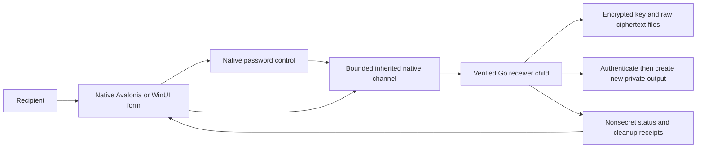

# FUT-09: Windows 11 desktop GUI research

Research date: **2026-10-16**. Project: Zodiac Modern, optional offline recipient GUI around the Go receiver.

**Research hypothesis: Avalonia + C# + CommunityToolkit.Mvvm is a strong first native candidate, with WinUI 3 as its direct challenger.** Section 11 now defines a **GUI-only benchmark without the Go CLI** before choosing a framework or implementing the product. Tauri v2, Wails and Electron remain important measured alternatives. Any future Go receiver integration is a separate later stage.

This is a research recommendation, not framework selection, comparative benchmark results, security approval or release acceptance. No GUI, password library, runtime or dependency was installed for the original research assessment. The subsequent **native host implementation** is recorded in section 14; it restored two pinned SDK packages and tested the already-installed WebView2 runtime. No production private key was requested or inspected. Framework documentation establishes capabilities; the proposed experiments below must establish actual product behavior.

## 1. Scope, evidence and the decision being made

The requested comparison covers all 16 entries, counting standalone C# WebView2 and Wails separately. Several entries share the same browser engine but expose different development and security boundaries. Comparing only screenshots or executable sizes would miss the important differences.

Repository sources inspected:

- [Plan](../plan.md), especially optional delivery direction, receiver policy, accessibility, distribution and release gates.
- [Backlog](../backlog.md), FUT-09 and its research acceptance criteria, plus REC-04 cleanup behavior.
- [Current Go command](../receiver/cmd/zodiac-decrypt/main.go), including prompt injection seams, exit categories, authenticated output and finish/cleanup workflow.
- [Current password input](../receiver/internal/cli/password.go), which opens a controlling terminal, bounds input to 1,024 bytes and rejects ordinary redirected password input.

The working tree already had a change to `backlog.md`; this research does not modify it or mark FUT-09 complete. The `webview2-raw-bench` directory was empty at the original research inspection; the later host work in section 14 supplies host validation evidence, not comparative frontend measurements.

The backlog records Avalonia as the preferred candidate to evaluate and WPF as previously excluded by preference. The current request explicitly includes WPF WebView2, so it is compared here without silently making it a preferred implementation. This research concerns the receiver GUI. Hosted public-key encryption, verified offline HTML and the standalone CLI remain separate delivery paths. Go encryption remains FUT-11.

The user's follow-up explicitly allows researching changes to Go input and existing Electron password/CLI libraries. Accordingly, the current terminal interface is treated as an interface to extend deliberately, not a reason to dismiss Electron or any other GUI toolkit. No input-policy change is implemented here.

External evidence uses official documentation and upstream repositories. Section 13 additionally distinguishes original reporting/interviews, community reverse-engineering observations and the user's research notes. Links sit beside the claims they support. Evaluations such as “best fit,” likely engineering effort and expected footprint are **project-specific judgments**, not independently measured framework rankings. Documentation and release status are moving targets; pin exact SDK/runtime/package versions and source/license manifests at implementation selection.

## 2. What matters most for this application

Zodiac's recipient is a short, sensitive file operation rather than a browser, editor, dashboard or animation-heavy application. It needs an understandable workflow: choose ciphertext, choose encrypted private key, choose a new plaintext output, enter the key passphrase, decrypt, and explicitly finish any requested cleanup.

| Factor | Importance here | What a successful implementation must demonstrate |
| --- | --- | --- |
| Go policy ownership | Mandatory | Go retains key parsing, fixed PBES2 policy, RSA/OAEP/GCM, canonical decoding, bounds, safe output and cleanup; UI cannot bypass them |
| Portable, offline, standard-user launch | Mandatory | Extract verified release folder and run on a supported clean Windows 11 account without installer, administrator access or runtime download |
| Narrow operation boundary | Mandatory | No arbitrary shell, local web service, generic filesystem bridge or secret argv/environment/stdin/temp files |
| Secret lifetime and persistence | Mandatory | Short-lived password input, no automatic history or saved key contents, no plaintext in UI/IPC/logs; honest limits on erasure |
| Accessibility and international text | Mandatory | Keyboard, Narrator/NVDA, high contrast, scaling, Unicode filenames and Hebrew/bidirectional text in relevant controls |
| Correct cancellation and cleanup | Mandatory | No premature success, no silent deletion, no interrupted write reported as complete; distinct output/key cleanup receipts |
| Windows 11 integration | High | Familiar controls, system theme, title bar/Snap behavior, native file dialogs, DPI/monitor changes and predictable focus |
| Delivery and servicing | High | Signed first-party executables, final per-file hashes, trusted verification channel, manual reviewed releases; manageable runtime patch responsibility |
| Development and maintenance | High | Small codebase, reproducible dependency inventory, accessible UI tests, straightforward debugging and limited glue |
| Resource use | Medium | Fast usable launch, low idle activity and bounded working set across the whole process tree |
| Website reuse | Medium | Reuse design tokens, wording and appropriate presentational components; do not couple private-key code to hosted browser imports |
| Cross-platform reach | Optional | Useful future flexibility, but no justification for weakening today's Windows recipient experience |

Apply mandatory requirements before comparing convenience. A tiny EXE that downloads a runtime fails the strict first-launch requirement. A larger verified portable folder can satisfy it. Conversely, “self-contained” does not mean the OS writes no caches, DLLs never load, or plaintext can be securely erased.

## 3. Normalize the framework list first

| Entry | What actually renders the interface | What the developer owns |
| --- | --- | --- |
| Tauri v2 | HTML/CSS/JS in Windows WebView2 | Svelte/TypeScript UI, Rust command layer, Go child boundary |
| Electron | HTML/CSS/JS in bundled Chromium | Renderer/preload/main-process APIs, Node integration, Go child boundary |
| WinUI 3 / C# | Native WinUI XAML controls | C#/XAML app, Windows App SDK deployment, Go child boundary |
| WinUI 3 / C# + CommunityToolkit.Mvvm | Same native WinUI controls, XAML/bindings with MVVM | Separate native reference implementation and deployment |
| WinUI 3 / C# + Microsoft.UI.Reactor | Same native WinUI controls, C# declarative elements and MVU reconciliation | Experimental authoring layer, lifecycle/state and deployment |
| React Native for Windows | Fabric/Windows Composition host components, with native XAML hosting where used | React/TypeScript UI, native integration, release bundle and deployment |
| Slint / Rust | Compiled declarative Slint UI using the selected native backend/renderer | Rust app, Slint models/callbacks, renderer and license selection |
| Flutter | Flutter-rendered widgets and semantics | Dart UI, desktop plugins/native integration, Go child boundary |
| Standalone C# CoreWebView2 | WebView2 inside a native window | Window/controller lifecycle, local content, bridge, deployment and Go integration |
| Wails / Go | HTML/CSS/JS in WebView2 | Svelte/TypeScript UI, Go host/bindings and operation boundary |
| Wry / Tao / webview2-com | WebView2 through Rust webview/window/COM libraries | A substantial portion of the desktop host framework |
| PyWebView | HTML/CSS/JS in a selected platform webview | Python host/bridge, freezer/runtime dependencies and Go integration |
| C++ official WebView2 Win32 SDK | WebView2 in a Win32 host | COM, windowing, message pump, content/bridge, deployment and Go integration |
| Dear ImGui / Win32 + DX11 or DX12 | Immediate-mode controls submitted to a selected Direct3D backend | Rendering/present loop, styling, accessibility/internationalization and Go integration |
| Blazor Hybrid WebView2 | Razor components rendered into an embedded webview; .NET code runs natively | .NET host, Razor UI, WebView2 boundary and Go integration |
| WPF Microsoft.Web.WebView2 | WebView2 hosted in a WPF control | WPF shell/lifecycle plus HTML UI/bridge and Go integration |
| WinUI 3 built-in WebView2 | WebView2 hosted in a WinUI XAML control | WinUI shell/lifecycle plus HTML UI/bridge and Go integration |
| Avalonia + CommunityToolkit.Mvvm | Avalonia controls drawn using its rendering stack | C#/AXAML UI, MVVM state and Go child boundary |
| Qt / QML / C++ | Qt Quick scene graph and controls | QML/C++ UI, plugins/runtime deployment and Go child boundary |
| wxWidgets / C++ | Primarily platform-native controls | C++ UI/application code, platform polish and Go child boundary |

CoreWebView2 is an API, not a complete UI toolkit: it needs a window/controller host. WPF, WinUI and Win32 wrappers ultimately use the same WebView2 platform. A native WinUI app does **not** require a webview merely because WinUI offers one. Microsoft's [hosting comparison](https://learn.microsoft.com/en-us/windows/apps/develop/ui/controls/webview2) describes these wrapper differences.

Avalonia uses Skia and Windows platform integration; its Fluent theme does not turn its controls into WinUI controls. Its current Windows documentation describes GPU rendering through ANGLE/Direct3D with a software fallback. See [Avalonia Windows integration](https://docs.avaloniaui.net/docs/platform-specific-guides/windows/). Likewise, Qt's FluentWinUI3 style explicitly says it is a native-looking style rather than native WinUI controls. See [Qt FluentWinUI3](https://doc.qt.io/qt-6/qtquickcontrols-fluentwinui3.html).

## 4. Comparative decision matrix

These are qualitative expectations for a small, competently implemented Zodiac receiver. “Good candidate” means plausible with the listed work, not tested acceptance. Browser footprint includes browser subprocesses; executable size alone is misleading.

| Candidate | Win11 visual/interaction starting point | Existing Svelte reuse | Strict portable offline route | Expected footprint/servicing issue | Assessment for Zodiac |
| --- | --- | --- | --- | --- | --- |
| Avalonia + MVVM Toolkit | Strong Fluent-style starting point; platform details need verification | Design/assets only | Bundle .NET/native dependencies, or validate Native AOT | No browser; managed/native graphics dependencies | **First prototype** |
| WinUI 3 native | Strongest direct match to Windows controls and design | Design/assets only | Unpackaged self-contained .NET + Windows App SDK | More Windows deployment machinery | **Direct challenger** |
| Tauri v2 | Highly customizable web UI; desktop behavior must be designed | High | Existing supported WebView2, or bundle Fixed Version | Shared browser if present; bundled runtime changes size/patching | **Best structured Rust/web option** |
| Wails | Highly customizable web UI; desktop behavior must be designed | High | Existing supported WebView2, or bundle Fixed Version | Go/web stack; bindings and runtime profile need review | **Best Go/web productivity option** |
| Electron | Excellent web UI tooling; Windows-native feel needs deliberate work | High | Ship Chromium/Node with portable app folder | Larger engine payload; app team services Chromium/Node | **Viable if its advantages are wanted** |
| Flutter | Strong custom UI; Windows conventions need adaptation | None directly | Ship engine, data, plugins and app-local CRT dependencies | Engine/assets and Dart/plugin stack | Good framework, weaker fit for this repository |
| Standalone C# WebView2 | Whatever the host and web frontend implement | High | Bundle .NET and fixed browser, or rely on installed browser runtime | Lower host abstraction; more custom lifecycle/security glue | Good focused Windows webview spike |
| WPF WebView2 | Mature shell plus web frontend | High | Self-contained .NET plus WebView2 strategy | Two UI stacks plus browser profile | Technically sound; previous preference lowers priority |
| WinUI WebView2 | Modern shell plus web frontend | High | .NET + Windows App SDK + WebView2 strategy | Three substantial deployment components | Use only for a concrete native/web split |
| Wry / Tao / webview2-com | Low-level window plus web frontend | High | Native Rust host plus WebView2 strategy | Fewer high-level helpers; more owned framework code | Specialized alternative, not first choice |
| C++ WebView2 Win32 SDK | Low-level Win32 shell plus web frontend | High | App-local/static CRT decisions plus WebView2 strategy | Direct COM/lifecycle and memory-safety responsibility | Only with strong C++ ownership |
| Blazor Hybrid | .NET shell plus Razor web UI | Low; Svelte rewrite or awkward mixed UI | .NET + host dependencies + WebView2 | Both .NET and browser servicing | Useful for an existing Razor team, weak reuse here |
| Qt Quick/QML | Strong custom desktop UI; Fluent-like styling available | None directly | Ship Qt/QML/plugins/CRT with audited module set | Deployment and licensing need deliberate attention | Credible with existing Qt expertise |
| wxWidgets | Familiar native controls, less immediate Fluent polish | None directly | Ship app and necessary libraries/CRT | Potentially lean; bespoke styling costs engineering time | Sensible utility toolkit, not preferred for this design goal |
| PyWebView | Web frontend quality; host depends on selected engine | High | Freeze Python and dependencies plus explicit modern webview | Python/.NET/backend/freezer composition | Prototype-friendly; adds an unnecessary runtime here |
| Dear ImGui | dx11-12 Custom tool aesthetic rather than a standard recipient form | None directly | Native application/backend dependencies | Can be lean, but accessibility/i18n work dominates | **Reject for this recipient product** |

### Accessibility, Go integration and development cost

| Family | Accessibility foundation | Go integration | Main development/testing cost |
| --- | --- | --- | --- |
| Native WinUI | Windows control semantics and UI Automation | Child process + reviewed native handoff | Packaging, async lifecycle, focus and cancellation |
| Avalonia | Automation peers and Windows UI Automation | Child process + reviewed native handoff | Verify actual AT behavior, scaling, graphics fallback and secret-control behavior |
| Browser UI: Electron/Tauri/Wails/raw WebView2 | Browser accessibility tree plus semantic HTML | Host API + child process, or Go host | DOM/ARIA quality, cross-boundary focus, origins, bridge permissions and profile writes |
| Flutter | Semantics/accessibility system | Dart process/native integration | Desktop keyboard/AT behavior and plugin quality |
| Qt Quick | Qt accessibility interfaces and accessible QML controls | C++ process APIs + handoff | Accessible custom controls, QML/plugin deployment and licensing |
| wxWidgets | Platform control behavior where native controls are used | C++ process APIs + handoff | Custom controls and modern visual polish |
| Dear ImGui | Upstream documents missing accessibility and full internationalization | Native process integration | Building missing product foundations, not merely adding labels |

Avalonia documents [automation peers and Windows UIA](https://docs.avaloniaui.net/docs/app-development/accessibility); Flutter provides [accessibility guidance](https://docs.flutter.dev/ui/accessibility); Qt documents its [accessibility interfaces](https://doc.qt.io/qt-6/accessible.html). These are foundations, not evidence that our eventual password dialog, custom title bar or operation status is accessible. Dear ImGui's [own stated limitations](https://github.com/ocornut/imgui#the-pitch) are particularly material for this project.

## 5. Individual framework findings

### 5.1 Avalonia / C# / CommunityToolkit.Mvvm

**Why it leads this research:** a receiver with a handful of controls does not gain much from a complete browser engine, while self-contained .NET deployment offers a practical route to an offline portable folder. Avalonia can provide a calm branded UI without importing HTML, JavaScript execution, navigation and browser profiles into the recipient workflow. Cross-platform potential is useful but secondary.

Use the official Fluent theme first. CommunityToolkit.Mvvm supplies framework-independent observable state and commands; it is not a rendering framework or Avalonia skin. Suitable uses are operation state, async commands, button eligibility and nonsecret validation. Keep passwords out of generated observable properties, message buses and generic diagnostic object dumps. See [Avalonia themes](https://docs.avaloniaui.net/docs/styling/themes) and [Microsoft's MVVM Toolkit introduction](https://learn.microsoft.com/en-us/dotnet/communitytoolkit/mvvm/).

The costs are a second application language alongside Go/TypeScript, no direct reuse of Svelte markup, and responsibility for confirming Windows behavior that WinUI supplies more directly. Drawn controls still need correct automation peers. Native file dialogs and window integration do not prove every rendered control has native behavior.

Start with an architecture-specific self-contained folder. Treat Native AOT as a measured packaging/startup optimization, not a security feature or initial prerequisite. Avalonia supports it, but compiled bindings, static assets and reflection/trimming compatibility matter; third-party controls can complicate it. See [Native AOT deployment](https://docs.avaloniaui.net/docs/deployment/native-aot). Do not select a complex theme/control suite just to reproduce a few WinUI visuals.

**Decision:** first candidate, conditional on a real no-runtime-download release build and successful Narrator/NVDA, Unicode, DPI and native handoff trials.

### 5.2 WinUI 3 / C#, with native controls

**Best reason to choose it:** Windows 11 is the actual target and authentic Windows interaction has greater value than future portability or reusing web markup. Microsoft's recommended native development path is WinUI 3. Native XAML controls, Windows styling, system accessibility integration and window APIs make it the strongest direct baseline for that goal. See [Microsoft's Windows development guidance](https://learn.microsoft.com/en-us/windows/apps/whats-new/coming-to-windows).

CommunityToolkit.Mvvm can be used here too; MVVM is not an exclusive Avalonia advantage. The crypto/output boundary can be identical to Avalonia's. Avoid a WebView2 control unless a specifically justified feature needs HTML.

Deployment needs attention: bundle both .NET and Windows App SDK dependencies for an unpackaged self-contained release. Do not assume a default packaged/framework-dependent Visual Studio template is portable. Microsoft's [self-contained guide](https://learn.microsoft.com/en-us/windows/apps/package-and-deploy/self-contained-deploy/deploy-self-contained-apps) supports folder deployment. Its [unpackaged guide](https://learn.microsoft.com/en-us/windows/apps/package-and-deploy/unpackage-winui-app) now documents an extraction-based single-file route. The broader self-contained page still contains a conflicting single-file sentence. Therefore, neither “WinUI can never ship one EXE” nor “one EXE means no extracted dependencies” is a sound selection argument. Test the pinned toolchain; use a folder as the baseline.

**Decision:** strongest challenger. Prefer it over Avalonia if a prototype demonstrates materially better accessibility/Windows behavior with acceptable delivery complexity. Future cross-platform support is not a requirement that should automatically defeat it.

### 5.3 Tauri v2

**Best reason to choose it:** reuse Svelte/CSS and established web accessibility work while getting a structured Rust host with capability controls and sidecar packaging. Tauri embeds external executables, so a Go receiver is a supported architectural shape. See [sidecars](https://v2.tauri.app/develop/sidecar/) and [capabilities](https://v2.tauri.app/security/capabilities/).

Keep frontend authority small: request a file selection or one bounded operation, rather than exposing a generic shell plugin to JavaScript. Packaging a sidecar does not authenticate its bytes or solve passwords, cancellation, output races or cleanup. Review application commands as well as plugins; “uses capabilities” is not evidence that custom Rust code validates inputs. Avoid overlapping capabilities that unintentionally broaden access.

Costs: Rust + TypeScript + Go toolchains, a web/native bridge and the shared WebView2 deployment tradeoff. This is smaller than bundling Chromium only when the installed runtime is available or its size is omitted from the comparison. Use bundled local assets/protocol handling, not the hosted website or a localhost server. Tauri's [architecture/repository](https://github.com/tauri-apps/tauri) describes its platform webviews and local protocol approach.

**Decision:** preferred structured web/Rust wrapper if Svelte reuse is decisive and the team accepts Rust. A native password dialog can keep secrets outside the DOM even with a web-based main window.

### 5.4 Wails / Go

**Best reason to choose it:** Svelte UI with a Go host, avoiding an extra Rust or C# application layer. It is especially attractive if the eventual design deliberately shares a Go operation service between the CLI and a desktop executable. That is a different architecture from launching an unchanged CLI; document which one is selected.

For FUT-09's sidecar direction, keep Wails' Go host thin and launch a pinned receiver child. If integrating the receiver into the Wails host process instead, its key material then shares a process with webview-host glue. Reusing Go packages is possible, but does not preserve a separate process boundary. Do not accidentally conflate “same language” with “same security properties.”

Current upstream documentation identifies **v2.15.0** on the v2 Windows guide and **v3 as beta**, not stable. Recheck at selection; do not mix v2 implementation examples with v3 APIs. See [v2 Windows guide](https://wails.io/docs/guides/windows/) and [v3 status](https://v3.wails.io/status/).

Review bound methods, event payloads, origin handling and logging. The [v2 options reference](https://wails.io/docs/reference/options/) exposes binding-origin and asset-handler configuration; allow no additional remote origins. An “asset server” abstraction does not by itself establish whether a network socket is used: inspect and test the exact release path for the selected version.

**Decision:** first Go/web candidate. Compare against Tauri on actual host/IPC simplicity, not a claim that either framework is inherently secure.

### 5.5 Electron

**Best reason to choose it:** mature web development workflow, consistent bundled Chromium, broad desktop tooling, and established process/terminal integrations. Svelte can be reused, and users need neither Node nor WebView2 installed when the complete app is shipped. This directly addresses the clean offline machine case, at the cost of carrying the browser/runtime.

The receiver UI would use a sandboxed renderer without Node integration, context isolation, a narrow preload API, validated IPC senders, local content and restrictive CSP/navigation. The main process launches the exact Go binary without a shell. Electron documents these measures in its [security checklist](https://www.electronjs.org/docs/latest/tutorial/security). They require implementation and review; an Electron default template is not the finished policy.

Electron has credible solutions for password entry and terminal integration; section 8 evaluates them. It should not be rejected because the present Go command reads a controlling terminal. Conversely, adding a prompt library does not define the child-process protocol or memory lifetime.

Costs: browser/Node payload, multiple processes, dependency/patch cadence and maintaining compatibility for native modules if chosen. A bundled engine provides predictable release bytes, but fixing its vulnerabilities requires a new manually distributed app release under this project's no-updater policy. A portable app folder is a better starting point than a self-extracting one-file wrapper. Do not assume ASAR packaging makes scripts confidential or authenticates every dependency.

**Decision:** viable, particularly if consistent Chromium or terminal tooling outweighs footprint and servicing. It is not the first choice for a small receiver, but it is not disqualified by password handling.

### 5.6 Flutter

Flutter offers productive custom UI development and reusable desktop/mobile widgets, with no browser engine required for the main interface. It brings a new Dart UI and plugin ecosystem rather than reusing Svelte. Windows-looking Fluent controls are available through a community package linked by Flutter; they are not WinUI controls. See [Flutter's Windows integration guidance](https://docs.flutter.dev/platform-integration/windows/building).

The Go sidecar remains practical, but native handle transfer/password integration may need Windows FFI or plugin code. An integrated Go DLL would add a separate FFI design and review obligation. For a Windows-only file decryptor these layers buy less than they would for a genuinely shared mobile/desktop product.

Portable distribution must include engine DLLs, data and required Visual C++ runtime components; Flutter documents an app-local ZIP route. Test screen-reader semantics, keyboard conventions, scaling, native dialogs and software/remote-session behavior in the actual release configuration. Do not infer Windows accessibility from a successful Android demonstration.

**Decision:** good technology, currently less aligned than Avalonia/WinUI or a Svelte wrapper. Reconsider if mobile-native clients become a real selected requirement.

### 5.7 Standalone WebView2 / C# CoreWebView2

This is a focused way to host an entirely local Svelte interface while keeping direct access to Microsoft WebView2 APIs. Choose a minimal native host explicitly: Win32 HWND/controller interop, WinForms, or another supported shell. “CoreWebView2 only” does not remove windowing or .NET dependencies.

Advantages are precise navigation/resource policy and fewer high-level framework conventions. Costs are owning initialization, STA/UI-thread scheduling, lifetime, browser failures, profile location, bridge validation, dialogs, packaging and tests. Native password UI can remain outside the webview, but still needs an implementation.

Microsoft specifically recommends origin checks, message validation and avoiding generic host proxies in [secure WebView2 development](https://learn.microsoft.com/en-us/microsoft-edge/webview2/concepts/security). Its [Win32 sample](https://learn.microsoft.com/en-us/microsoft-edge/webview2/get-started/win32) also shows how much hosting machinery exists beneath wrappers.

**Decision:** a useful Windows-only baseline or narrow spike. Choose it over Tauri/Wails when direct API control demonstrably simplifies the actual product, not merely because the first window needs fewer source files.

### 5.8 Wry / Tao / webview2-com

These are related building blocks, not three interchangeable complete frameworks. [Wry](https://github.com/tauri-apps/wry) supplies cross-platform webview abstraction; [Tao](https://github.com/tauri-apps/tao) supplies window/event-loop facilities; [webview2-com](https://github.com/wravery/webview2-rs) exposes Windows WebView2 COM bindings. Use the level required rather than assuming every app needs all three directly.

They can support a lean Rust host with local Svelte UI and Go child, but you then own capabilities/command validation, resource policy, packaging, lifecycle and security tests that a fuller framework helps structure. Rust reduces some classes of host memory errors; it does not validate IPC semantics, remove unsafe COM interactions or protect a compromised webview from overly broad commands.

**Decision:** justified for a team deliberately building and maintaining a minimal desktop host, or needing APIs absent from a higher-level wrapper. Excessive custom infrastructure for this receiver as a first implementation.

### 5.9 PyWebView

PyWebView offers a compact Python API and reuse of web UI. Its upstream [web-engine guide](https://pywebview.flowrl.com/guide/web_engine.html) documents Windows EdgeChromium and legacy fallback possibilities; explicitly require a modern selected backend and fail closed rather than falling back to MSHTML. Verify current pinned backend requirements rather than relying on an old sample.

Its [freezing guide](https://pywebview.flowrl.com/guide/freezing.html) supports Windows packaging through PyInstaller/Nuitka and warns that unwanted installed UI dependencies can be included. A small Python source file is not a small dependency inventory. A one-file freezer also needs extraction behavior assessed.

For Zodiac, Python adds little beside the existing Go and TypeScript stacks. Browser host controls and secret-copy handling need inspection, and a Python-to-Go bridge adds another managed runtime. Do not adopt a Flask/REST example: this project forbids a listener. The upstream [security guide](https://pywebview.flowrl.com/guide/security.html) discusses server-based patterns but does not require that architecture.

**Decision:** reasonable for an existing Python product or disposable UI prototype; weak production fit here.

### 5.10 Modern C++ with the official WebView2 Win32 SDK

Direct official SDK use provides the most immediate access to WebView2 APIs and avoids another managed host runtime. It still uses the browser runtime. Own the HWND, COM references/callbacks, STA message pump, asynchronous teardown, resource serving, bridge and all deployment details. See [Microsoft's Win32 getting-started example](https://learn.microsoft.com/en-us/microsoft-edge/webview2/get-started/win32).

A C++ host can be compact, but manual lifetime/memory handling increases implementation-review cost. Keep receiver crypto in Go rather than porting it merely because the UI is C++. Verify CRT and loader dependencies, use deliberate DLL loading/search behavior and test both x64 and ARM64 artifacts if supported.

**Decision:** credible for experienced Windows C++ maintainers needing direct control. There is no application requirement here that presently justifies this extra ownership over C#/Tauri/Wails.

### 5.11 Dear ImGui

Dear ImGui is excellent for developer tools and graphics/debug interfaces. Upstream explicitly states that accessibility and full internationalization, including bidirectional shaping, are not supported in its intended baseline. See its [project description](https://github.com/ocornut/imgui).

That conflicts directly with a novice-facing recipient workflow, screen-reader acceptance and international text needs. Password masking, custom fonts or keyboard navigation would not fill those gaps. A graphics loop's speed is not the relevant bottleneck for PBKDF2 plus safe file output.

**Decision:** reject for the product GUI. Reconsider only for a separate internal diagnostic tool with different requirements and no real secrets in its diagnostics.

### 5.12 Blazor Hybrid / WebView2

Blazor Hybrid runs Razor component logic in the native .NET process and renders into an embedded webview; it is not necessarily a local ASP.NET HTTP server or WebAssembly application. Microsoft's supported desktop hosting paths include WPF and Windows Forms. See [Blazor Hybrid overview](https://learn.microsoft.com/en-us/aspnet/core/blazor/hybrid/).

It can operate offline and call a Go child. However, the existing Svelte UI does not become Razor components automatically. Combining Svelte and Blazor would add integration rather than simplify it. Browser content and native .NET code still need a restricted boundary; see [Microsoft's Hybrid security guidance](https://learn.microsoft.com/en-us/aspnet/core/blazor/hybrid/security/).

No .NET MAUI shortlist expansion is needed: Hybrid and MAUI are not synonyms. For this repository, plain Avalonia/WinUI or a Svelte-oriented host is more direct.

**Decision:** choose when substantial existing Razor/.NET UI or team expertise creates a concrete benefit. Otherwise it adds a rewrite and a browser simultaneously.

### 5.13 Microsoft.Web.WebView2 in WPF

WPF is a maintained Windows UI framework, not deprecated because WinUI exists. Microsoft added a Fluent theme in .NET 9; see [WPF changes](https://learn.microsoft.com/en-us/dotnet/desktop/wpf/whats-new/net90). `Microsoft.Web.WebView2` supplies the WPF webview integration; it is not a replacement for WPF itself.

This can combine mature window/dialog/data-binding behavior, a native password control and a Svelte main view. Self-contained .NET plus a browser runtime policy can produce a portable folder. Hosting a webview inherits the same profile, bridge, navigation and browser servicing concerns as other WebView2 options.

If starting a wholly native form, compare native WPF separately; it would be a different design from the requested WPF webview wrapper. The current preference history lowers its priority, but its technical capabilities should be represented accurately.

**Decision:** technically viable; particularly sensible for existing WPF assets/expertise. Not a preferred new prototype under the recorded preferences.

### 5.14 Built-in WebView2 in WinUI 3

The built-in `Microsoft.UI.Xaml.Controls.WebView2` provides a WinUI host for the same browser platform; see [the control documentation](https://learn.microsoft.com/en-us/windows/apps/develop/ui/controls/webview2). It can give native navigation/dialog chrome around selected web content.

For an entirely web-rendered receiver form, this carries WinUI/Windows App SDK deployment alongside WebView2 without getting native controls inside that form. It can be justified if substantial native screens coexist with a genuinely valuable web screen. A native password dialog is possible, but other hosts can also provide one.

**Decision:** use for a documented mixed native/web requirement. Choose native WinUI alone if the small receiver can be expressed naturally with native controls.

### 5.15 Qt / QML / C++

Qt Quick can create polished desktop interfaces, has established internationalization/accessibility facilities and does not need a browser engine for a normal QML UI. It requires a new QML/C++ UI and a Go child integration. QML is a scripting-capable UI runtime, so keep assets trusted/local and expose narrow C++ APIs.

Qt's [FluentWinUI3 style](https://doc.qt.io/qt-6/qtquickcontrols-fluentwinui3.html) is available but not native WinUI; its documentation lists controls that fall back to another style. A visual sample is not evidence of complete Fluent behavior. [Windows deployment](https://doc.qt.io/qt-6/windows-deployment.html) includes Qt libraries, QML imports, plugins and runtime dependencies.

Licensing is a real selection factor: Qt offers commercial and open-source options, with module-specific LGPL/GPL differences. Audit the selected module/plugin set and distribution obligations before selecting static linking or promising a proprietary one-file release. See [Qt licensing](https://doc.qt.io/qt-6/licensing.html).

**Decision:** strong if the maintainer already knows Qt or needs a sophisticated cross-platform native client. Its advantages do not currently offset the new stack and distribution work for this short workflow.

### 5.16 wxWidgets / C++

wxWidgets primarily wraps native platform controls, with a long-established desktop API and cross-platform support. See its [overview](https://wxwidgets.org/about/). It can be a sensible, lightweight file utility with native dialogs and a Go child, without browser storage/IPC.

Its challenge here is achieving the desired contemporary visual finish without replacing so many controls with owner-drawn elements that native accessibility benefits are lost. Dark theme, DPI, title bar and custom-control behavior need real Windows trials. C++ process/lifetime and packaging code still require ownership.

The [wxWindows Library Licence](https://wxwidgets.org/about/licence/) includes an exception allowing application binaries to be distributed under the developer's own terms. Third-party components still need an inventory.

**Decision:** a practical native utility choice for an experienced wxWidgets team, but a less direct route to the requested modern design than the leading candidates.

## 6. Offline packaging, footprint and runtime servicing

### WebView2's important qualification

Windows 11 normally includes Evergreen WebView2, but Microsoft still instructs applications to detect availability. Edge browser installation is not a substitute for the production WebView2 Runtime. A bootstrapper that installs without admin is still an installation and can require networking; it does not meet “no install/no download.” See [Microsoft's runtime distribution requirements](https://learn.microsoft.com/en-us/microsoft-edge/webview2/concepts/distribution).

| WebView2 strategy | Benefits | Consequences for FUT-09 |
| --- | --- | --- |
| Use installed Evergreen | Small app payload; shared runtime; independently serviced browser | Version/availability not pinned with the release; may fail on a modified/managed/offline machine |
| Include Evergreen installer | Can support machines missing the runtime | Changes the no-install requirement; a bootstrapper is not the complete runtime |
| Bundle Fixed Version | Release carries a known runtime and needs no runtime installer | Much larger folder, architecture-specific files, runtime patch responsibility moves to us |

This applies to Tauri, Wails, standalone C#, Rust/C++ wrappers, WPF/WinUI webviews and WebView2-based Hybrid hosts. Microsoft's page currently describes unpacked Fixed Version binaries as **over 250 MB**. Tauri's installer guide estimates about **180 MB added to its installer**. These describe different artifacts/compression and are not interchangeable measured sizes. See [Microsoft distribution](https://learn.microsoft.com/en-us/microsoft-edge/webview2/concepts/distribution) and [Tauri fixed-runtime packaging](https://v2.tauri.app/distribute/windows-installer/#fixed-version). Measure the selected version's ZIP and extracted folder, including Go and assets.

An Evergreen-based variant can be offered as a smaller explicitly conditional download, but it is not the proof for the strict missing-runtime acceptance case. Preserve browser sandboxing; do not use relaxed flags to make portable launch work.

### Other runtimes

- **Avalonia:** self-contained .NET and native graphics dependencies, or a separately validated Native AOT build. No browser runtime for the proposed native UI.
- **WinUI native:** self-contained .NET **and** Windows App SDK; avoid APIs that require additional package installation for this portable scope.
- **Electron:** ships its own engine/runtime. Compare its full release folder with a WebView2 folder that also bundles the browser.
- **Flutter:** engine, assets, plugins and app-local CRT dependencies; a portable ZIP is explicitly documented.
- **Qt/wxWidgets/C++:** bundle the actual DLL/plugin/CRT set or make supported static-linking choices after licensing review. Native compilation alone does not mean zero external dependencies.
- **PyWebView:** include the selected Python/freezer/backend dependency set and browser requirement; forbid legacy fallback.

Shared browser/runtime updates and the application's updater are different mechanisms. The project can omit its own updater while using Evergreen, but must disclose that the underlying runtime changes independently. Conversely, a fixed browser, bundled Electron, self-contained .NET or bundled Qt all create manual patch responsibilities. Pinning provides repeatable bytes, not permanent safety. Microsoft's [runtime model comparison](https://learn.microsoft.com/en-us/microsoft-edge/webview2/concepts/evergreen-vs-fixed-version) explains the browser distinction.

### Persistence deserves its own test

WebView2 uses a user data folder for browser state/cache. Absence of `localStorage` calls does not mean there are no runtime files. Choose an isolated local profile, disable unnecessary password/autofill/history facilities, avoid placing user secrets in web content, and test runtime writes and process shutdown. Deleting the profile afterwards is best effort, not erasure. See [WebView2 user data folders](https://learn.microsoft.com/en-us/microsoft-edge/webview2/concepts/user-data-folder).

For every framework, inspect settings stores, dialog recent-path behavior, Windows recent items, crash/error reports, logs, temp extraction and diagnostics. Preserve **no application message/key/passphrase history**; document unavoidable OS/runtime artifacts accurately. A native UI removes browser-profile behavior but does not make Windows or the CLR stop writing all artifacts.

## 7. Licensing and long-term ownership

| Components | Upstream licensing starting point | What the release must still inventory |
| --- | --- | --- |
| Avalonia; MVVM Toolkit | MIT: [Avalonia licence](https://github.com/AvaloniaUI/Avalonia/blob/main/licence.md), [Toolkit](https://github.com/CommunityToolkit/dotnet) | .NET, Skia/native graphics, fonts, icons, any optional paid tooling or controls; do not confuse core Avalonia with commercial XPF |
| Tauri; Wry; Tao | MIT/Apache-2.0 alternatives in upstream repositories: [Tauri](https://github.com/tauri-apps/tauri), [Wry](https://github.com/tauri-apps/wry), [Tao](https://github.com/tauri-apps/tao) | Rust crates, plugins, platform runtime redistribution, frontend packages |
| webview2-com | MIT: [upstream bindings](https://github.com/wravery/webview2-rs) | Generated/native bindings, Windows crates, SDK loader and WebView2 runtime terms |
| Electron | MIT: [Electron license](https://github.com/electron/electron/blob/main/LICENSE) | Chromium/Node and third-party notices, npm/native modules and assets |
| Wails | MIT: [upstream](https://github.com/wailsapp/wails) | Go host dependencies, frontend packages, WebView2 distribution |
| Flutter | BSD-3-Clause: [Flutter license](https://github.com/flutter/flutter/blob/master/LICENSE) | Engine notices, plugins, community Fluent library, CRT and assets |
| WinUI/WPF/C#/Blazor/WebView2 | WinUI source uses MIT: [WinUI license](https://github.com/microsoft/microsoft-ui-xaml/blob/main/LICENSE); packages and runtimes have their own terms | Exact .NET/Windows App SDK/WebView2 packages and redistribution terms; a source license is not the entire runtime license |
| PyWebView | BSD-3-Clause: [upstream](https://github.com/r0x0r/pywebview) | Python, freezer, pythonnet/.NET/backend packages and chosen browser |
| Dear ImGui | MIT: [upstream](https://github.com/ocornut/imgui) | Backend libraries, fonts/assets and any accessibility extensions |
| Qt | Commercial or module-dependent LGPL/GPL: [Qt licensing](https://doc.qt.io/qt-6/licensing.html) | Each module/plugin, linking/relinking obligations, notices and source obligations; review before packaging |
| wxWidgets | wxWindows Library Licence with application distribution exception: [licence](https://wxwidgets.org/about/licence/) | Bundled dependencies and any custom controls |

For a small maintainer team, ongoing ownership matters more than a framework's popularity. Avalonia/WinUI add C#/XAML skills; Tauri adds Rust; Flutter adds Dart; Qt/wx/raw C++ add substantial C++/Windows work. Wails aligns most closely with Go + TypeScript. Electron aligns with TypeScript/Node but brings the largest obvious engine-servicing responsibility. “Few lines of application code” can hide a large dependency graph or an unstructured native bridge.

## 8. Password entry: Electron libraries and possible Go changes

**Password input is solvable in every serious candidate. It is not a unique Electron blocker or advantage.** Separate three questions: which control collects the password, which processes see it, and how Go receives it. Asterisks only address shoulder-surfing; they do not answer the latter two.

### Existing Electron/CLI options

| Option | What it actually supplies | Fit for the current receiver |
| --- | --- | --- |
| `@inquirer/password` / Inquirer prompts | Interactive terminal password prompt in Node | Useful for a Node CLI, not a desktop input control or Go transport; still needs a terminal and a handoff |
| `electron-prompt` | Electron prompt window with configurable HTML input attributes | Can collect a masked password, but produces JS/renderer/IPC copies; not a native protected-input guarantee |
| `node-pty` / Windows ConPTY | A real pseudoconsole hosting a CLI; used by applications including VS Code | Plausible compatibility route for terminal-oriented Go, with exact console behavior still needing tests |
| Electron's built-in `dialog` | Native file/message/error dialog APIs | Useful for file selection; no general password-entry method in its documented API |
| A small native password helper/dialog | Native entry outside the web renderer | Works with Electron or any other shell; adds native implementation/review and ownership/focus work |

Sources: [Inquirer password prompt](https://github.com/SBoudrias/Inquirer.js#password), [`electron-prompt` options](https://github.com/p-sam/electron-prompt), [`node-pty` Windows support and users](https://github.com/microsoft/node-pty), [Electron dialog API](https://www.electronjs.org/docs/latest/api/dialog). These are feature checks, not audits or endorsements of pinned versions. A library example that logs a prompt result must never be copied into this product's secret path.

Electron [`safeStorage`](https://www.electronjs.org/docs/latest/api/safe-storage) concerns encryption of persisted application data. Saving the key passphrase is not selected and this API is not a password input or ephemeral Go handoff solution.

### Compare the possible receiver input designs

| Design | Main advantage | Main cost/boundary | Research recommendation |
| --- | --- | --- | --- |
| Launch current CLI in a visible terminal | Keeps current hidden controlling-terminal prompt and policy | Terminal remains part of UX; not a fully graphical receiver | Useful baseline or explicit fallback |
| Embed terminal with ConPTY | Potentially preserves existing CLI interface inside app | JS/native terminal buffers, prompt/control-sequence state, input echo/cancellation and native module packaging | Valid experiment if keeping CLI unchanged matters |
| Go-side native password dialog | Password need not enter shell UI/DOM or cross process IPC | New Windows dialog adapter, accessibility/focus/Unicode work; less reuse of framework controls | Strong alternative when minimizing secret processes is the priority |
| Native shell password control + dedicated inherited channel | Consistent accessible UI and a narrow structured Go adapter | Password exists in shell and Go; explicit process/handle protocol needs review | **Preferred initial design for Avalonia/WinUI prototype** |
| Web password control + narrow host/native channel | Maximum web UI reuse; no extra native entry surface | Password reaches DOM/JS and host before Go; string/IPC copies and XSS exposure | Feasible, higher secret surface; assess deliberately |
| Add bounded stdin password mode | Simple familiar automation stream | Prohibited by current repository policy; changes CLI exposure and invocation contract | Researchable policy alternative, not selected here |
| Shared Go library/DLL in UI process | Avoids a child-process input protocol | FFI/cgo/runtime lifetime, Go DLL packaging, same-process secrets; no separately running receiver boundary | Different architecture, defer unless justified |

The user permits considering Go input changes; that does not require replacing native PBKDF2, modifying the envelope or weakening file-output checks. A new graphical adapter can reuse the same operation service while the standalone CLI keeps its terminal-only default.

A controlled private stdin channel is not intrinsically insecure simply because it is a pipe. The current ban is a product-policy decision that avoids an ambient/automation secret input route. Conversely, passing a password through a differently numbered handle is not magically safer. A new dedicated channel is useful because it can have explicit ownership, framing, allowed messages, process binding and no accidental terminal/stdio logging. Specify and review that contract openly rather than disguising piped stdin under a new name.

For ConPTY, `node-pty` establishes platform capability, not compatibility with this receiver. Test `CONIN$`/`CONOUT$`, raw mode, `x/term.IsTerminal`, backspace, 1,024-byte UTF-8 bounds, CR/LF, cancellation, missing console, finish prompt and echo suppression. Do not scrape English prompt text to decide when to inject a password. Do not spawn PowerShell/cmd to construct a command; execute the receiver directly. An embedded terminal increases functionality that a novice file-decrypt form does not otherwise need.

### Secret copies and erasure

All GUI paths need honest copy accounting: control buffer, framework string, UTF-8 conversion, IPC serialization, host runtime, Go buffer, PBKDF2 password string and OS buffers. Keep secrets out of MVVM properties, event broadcasts, JSON status objects, exception interpolation, traces, screenshots and crash-upload tools. Bound the original input and encoded bytes; preserve valid Unicode exactly and reject malformed UTF-16 rather than silently replacing it.

Masking, Native AOT, Rust, `SecureString` and renderer sandboxing do not establish guaranteed erasure. Microsoft's [SecureString discussion](https://learn.microsoft.com/en-us/dotnet/api/system.security.securestring) explicitly describes conversion/copy limitations. Clear owned mutable buffers and controls promptly, release references and make no stronger claim. A native Go-owned dialog reduces the number of processes that see the passphrase; it still cannot defeat a compromised user session.

## 9. Proposed architecture if Avalonia or WinUI is selected

This is a proposal for **later full-application work**, not an existing API or part of the GUI-only benchmark in section 11. If selected later, use a native receiver-only form and a Go child. The shell chooses paths and explains state; Go remains authoritative for all file and cryptographic decisions.



The diagram shows data access, not permission to send file contents back to the shell. Plaintext, private-key bytes and AES material stay in Go. The shell contains the passphrase briefly in this design; a Go-owned dialog removes that particular shell copy.

### Go changes worth designing

1. Extract operation orchestration from `cmd/zodiac-decrypt/main.go` into a small internal service shared by the CLI and graphical adapter. Reuse existing keyfile/envelope/localfile packages; do not duplicate their policy in C# or JS. This refactor and its regression evidence are new work, not already complete.
2. Keep CLI terminal input intact. Add an explicitly selected Windows GUI adapter/entry point, preferably built separately from the same Go module so existing `internal` packages remain reusable. Decide whether a new subcommand or a separately named signed GUI worker best preserves the public CLI contract.
3. Define one short-lived child session per operation. Accept selected paths/options and one bounded password submission. Return only fixed nonsecret status codes/receipts; no plaintext preview, raw key or free-form debug output.
4. Reuse the existing error taxonomy: input/usage 2, key-unlock 3, message failure 4, local I/O/cleanup 5, cancellation 130. Keep all unlock-profile/password/padding/private-key failures in the same category. A typed protocol must not introduce distinctions the CLI deliberately hides.
5. Model authenticated output success separately from completion of optional cleanup. Preserve the separate output/key cleanup outcomes and current best-effort semantics. A GUI cannot turn a worker crash into “cleaned successfully.”

### Inherited-channel contract to investigate

Prefer dedicated **anonymous inherited pipe handles**, separate from standard input, with an explicit handle allowlist. No HTTP/WebSocket/named-pipe server or addressable listener is needed. On Windows, use the supported process-creation/handle mechanisms rather than Unix fd assumptions. Microsoft documents [`PROC_THREAD_ATTRIBUTE_HANDLE_LIST`](https://learn.microsoft.com/en-us/windows/win32/api/processthreadsapi/nf-processthreadsapi-updateprocthreadattribute); Go's [`exec.Cmd.ExtraFiles`](https://pkg.go.dev/os/exec#Cmd) explicitly is not supported on Windows. The exact C#/Go/Rust adapter still needs a working spike.

Specify before implementation:

- A versioned, length-bounded frame grammar; cap path fields, total request size, password bytes and status frames before allocation. No unbounded line reader or generic object invocation.
- Allowed states/messages, one operation identifier, rejection of duplicates/replays/out-of-order frames, protocol version mismatch and unexpected EOF.
- Only intended child handles inherited; unused ends closed promptly; no global pipe name or reusable ambient endpoint. Handle identifiers/bootstrap metadata are not passwords, but still need validation.
- Password transmitted once as bounded bytes, never argv/env/stdin/JSON logging. The child checks exact bytes/limits; no trimming, normalization or lossy encoding.
- Full pinned executable path, no PATH search or shell, deliberately constrained working directory/DLL loading and least-privileged launch. Verify version/hash/publisher against the release manifest before starting. Review substitution/race limitations rather than assuming a hash check defeats a compromised local account.
- Graceful cancellation and completion acknowledgments, bounded waits, crash/disconnect handling and explicit file-state receipts. Do not kill a process in the middle of its output/cleanup operation and then infer the result.

A successful launch is not a sandbox. These processes share the user's account; local malware with debugging/injection privileges is outside this separation's protection. The benefit is a small auditable interface and reduced accidental exposure.

### If a webview wins instead

Keep the same Go operation service and child contract. Add a tiny native host API: choose files, start one operation, cancel, acknowledge finish and read nonsecret state. Prefer keeping password entry native; if web input is selected, record the expanded secret-copy boundary explicitly.

Bundle all UI assets locally. Block navigation, subframes, remote resources, popups, downloads and unneeded permissions. Reject web-message origin/frame mismatches and malformed payloads. Do not expose `run(command)`, arbitrary file read/write, eval, generic host-object reflection or arbitrary URL opening. Do not serve private files into the webview resource origin.

Carry over strict CSP requirements, including `style-src-attr 'none'` and `worker-src 'none'`. Framework-generated bootstraps and bridge transports may require a documented desktop-specific policy; inspect actual production assets and use the narrow required allowances. Do not solve compatibility by adding `unsafe-eval`, disabling web security or allowing generic network connections. Test browser extensions, profile behavior and runtime diagnostics rather than assuming a bundled local page has none.

## 10. How to make the app feel modern on Windows 11

The quality difference will come primarily from the workflow and interaction details, not acrylic effects. Use a compact single window with normal caption buttons, predictable resizing and a familiar title bar. Retain Snap, keyboard system menus and accessible focus behavior. Adopt restrained celestial branding in icons/accent color; keep instructional text and standard controls clear.

Proposed first receiver screen:

| Area | Proposed behavior |
| --- | --- |
| Message | Choose one raw ciphertext `.txt`; explain that PNG/SVG artwork is not a v1 receiver input |
| Private key | Choose one passphrase-encrypted PEM; never display or cache the private contents |
| Output | Choose a **new** plaintext filename; explain local/private/nonsynced location requirements; picker does not create or overwrite it |
| Cleanup options | Separate unchecked options for output cleanup and an explicitly designated single-use private key; explain irreversible intent and best-effort limits |
| Password | Short-lived masked native dialog/control; labeled, accessible, explicit cancel; no save-password option |
| Primary action | One clearly named “Decrypt to file” button; enabled only for a coherent form state |
| Status | Real stages: validating, unlocking, authenticating, writing, waiting for finish, cleanup result; no invented percentage |
| Completion | Distinguish “plaintext file written” from “requested cleanup completed”; never display plaintext or automatically launch an editor/clipboard |

The receiver's finish step lets the user read the saved file manually before requesting cleanup; show that lifecycle plainly. Closing the window, Cancel and “Finish reading” have different meanings. Define each with Go's operation state before coding the close handler. Never delete a key because the user closed a window before successful authenticated output.

Use system light/dark/high-contrast modes, accessible contrast and visible focus, minimum target sizes, appropriate text scaling, reduced-motion preferences and no essential information conveyed by color alone. Keep the UI thread responsive during PBKDF2 and exports. Do not imply cancellation interrupts an in-flight KDF immediately if the underlying call cannot be interrupted.

Test 100/150/200% DPI, multiple monitors, remote desktop/software rendering, long paths, Hebrew filenames and bidirectional isolation of path/status text. Display untrusted filenames as text and never turn them into commands or markup. Native pickers may show network locations; Go's existing local-disk/path/reparse/ACL checks must still reject unsupported input/output selections at the actual operation boundary.

Avoid automatic theme downloads, web documentation panels, analytics, recent-message lists, tray residency, startup registration, file associations and updates in the first GUI. They do not help the core recipient operation and expand persistence/delivery behavior.

## 11. Prototype and validation plan

**Planning only: no benchmark app, harness, scripts or measurements are implemented by this document.** The user's clarified scope is to compare the **Windows GUI applications themselves, without using the Go CLI**. Encrypt/Decrypt are UI test actions. No real encryption/decryption, receiver invocation, Go sidecar, IPC worker, key loading or passphrase handoff is part of this benchmark. Wails may naturally have a Go GUI host; that is its framework implementation, not use of the receiver CLI.

The aim is to choose a desktop UI development approach using measured usability, resource use, delivery and development effort. A winner here becomes a candidate for later application work; it does not automatically pass the separate receiver-integration/security gates below. Earlier recommendations are hypotheses until these trials are complete.

### 11.1 The shared benchmark window — NeutronStar GUI Bench

Build one small equivalent screen per framework, called **NeutronStar GUI Bench — synthetic test**. Start at **960 × 640 device-independent pixels**, with a minimum of 720 × 480 and normal resizing. Set 100% content zoom in webviews; verify equivalent effective size at each Windows DPI. Use the standard system title bar/caption behavior and equivalent spacing/colors. The broader native-framework cohort uses a system font with the same requested sizes. The later user-selected eight-web-frontend cohort uses the shared local typography/design contract in section 13.12; do not silently mix those typography variants in one comparison. Keep assets local and identical where applicable.

```text
+--------------------------------------------------------------------+
| NeutronStar GUI Bench — synthetic test             [min] [max] [x]   |
+--------------------------------------------------------------------+
| GUI framework: <name + version>          Theme: [System / Light / Dark]|
|                                                                    |
| +----------------------------+  +-------------------------------+  |
| | DECRYPT                    |  | ENCRYPT                       |  |
| | Synthetic action only      |  | Synthetic action only         |  |
| | [ Decrypt ]                |  | [ Encrypt ]                   |  |
| +----------------------------+  +-------------------------------+  |
|                                                                    |
| Test text: [short synthetic English / Hebrew  / emoji]              |
| [Run UI workload] [Cancel] [Reset]       Scenario: [Basic / Stress]   |
|                                                                    |
| Status: Ready                 Progress: <visible only during run>   |
| <bounded synthetic output area; stress rows only when selected>     |
+--------------------------------------------------------------------+
```

Decrypt stays on the **left**, Encrypt on the **right**. Use real accessible buttons, labels and focus order. Place buttons in two simple panels, not an imported full application component suite. Native candidates use their normal controls; web candidates use semantic HTML buttons/inputs. Pixel-perfect copying of one framework's control internals is unnecessary; functional/visual equivalence is required. Record material control/template differences.

Baseline behavior, identical across implementations:

- Clicking either button immediately changes its status, disables duplicate action submission, runs a **two-second asynchronous simulation**, and displays the same short completion text. This is a timer-driven UI state test, not simulated crypto throughput.
- During a run, update a simple progress indicator at **10 updates/second** using elapsed time. No progress timer runs when idle. Cancel stops that simulation and displays “Canceled”; Reset clears synthetic output and returns to Ready. Reduce/disable optional motion under reduced-motion settings.
- Keep test text bounded to 64 KiB of valid synthetic UTF-8; use the same versioned text fixture for each candidate. This is a UI-input limit only, not a new product payload or encryption implementation. Do not log contents or maintain input history.
- Basic mode has only the compact form/status controls. Stress mode adds the identical fixed set of **1,000 synthetic status rows** and, in a separately selected rendering scenario, **512 simple vector shapes**. Keep these off at startup and measure each separately. The shapes are test geometry, not a new glyph alphabet or an artwork importer.
- Include a conventional modal test dialog with a labeled **synthetic masked input** and OK/Cancel for focus/accessibility inspection. It receives a public fixture string only; no real passwords, storage, native secret helper or CLI handoff. Do not label this a tested secure-input solution.
- Optional native file-picker testing uses harmless fixture files; cancel returns to Ready. Pickers, clipboard, drag/drop, output-file writing and notification features are not needed for core timed workloads. Measure optional features separately so absent features do not inflate one candidate's score.

This provides more information than an empty two-button window while staying small. An empty-window measurement may be recorded as a secondary framework floor, but the shared functional window determines the main comparison. Do not build the website, full sender, full receiver, account system, updater or product navigation for this experiment.

### 11.2 Candidate coverage and controlled variants

Apply the same requirements to all 16 entries in this report. First record whether each can build/package the shared screen and which requirements it cannot reasonably meet. Use a suggested initial measured cohort of **Avalonia, native WinUI 3, Tauri v2, Wails, Electron and standalone C# CoreWebView2**. This includes competing native/web approaches and does not select the eventual framework. Add the other candidates when their baseline capability, team expertise or results justify the effort. A documentation-screened entry remains “not measured,” never a numeric loser with invented results.

Dear ImGui's documented accessibility/i18n gaps can be recorded as an early product-fit failure without building a replacement accessibility framework. WPF/WinUI-hosted WebView2, Rust and C++ wrappers must each have their own implementation/result if measured; they cannot inherit Tauri/Wails numbers merely because they share WebView2.

Use release builds, normal optimizations, equivalent functionality and the simplest maintained stable control/theme choices. Close IDEs, devtools, debuggers, HMR servers and overlays for normal runs. Record the actual compiler/framework/runtime versions, source revision and final executable/asset hashes. Keep prerequisites and benchmark build settings reproducible.

Separate variants rather than quietly mixing them:

| Variant | Purpose | Comparison rule |
| --- | --- | --- |
| Native/self-contained baseline | Actual portable release folder | Include all required app-local runtimes, DLLs, assets and notices |
| WebView2 with installed Evergreen | Smaller application relying on the machine runtime | Label exact prerequisite/version; do not claim this proves missing-runtime compatibility |
| WebView2 with bundled Fixed Version | Strict offline launch without a runtime installer | Include the full browser in size/resource/patching assessment |
| Avalonia/.NET Native AOT or other optional optimization | Measure a concrete improvement | Retain the ordinary baseline and measure added build/maintenance effort |
| One-file/self-extracting packaging | Evaluate distribution convenience | Measure extraction, disk writes and first-launch cost; do not compare only the wrapper EXE bytes |
| Custom visual polish | Check final achievable appearance | Run after baseline and record extra dependencies/code/resource cost |

For shared-WebView2 variants, pin the same runtime for the controlled comparison where possible; also test the normal supported Evergreen path separately. Do not force Electron onto a different Chromium build or disable its sandbox just to make engines match. Record engine versions and interpret remaining differences.

### 11.3 Environment and repeatability

Use one **physical Windows 11 reference machine** for comparative timing/rendering/resource results. Record CPU/core count, RAM, storage, GPU/driver, Windows build/patches, power mode, AC/battery state, display refresh rate, resolution and DPI. Keep browser/graphics/runtime versions and security settings stable during a comparison session. Run one candidate at a time under the same standard account and local nonsynced path.

A clean offline VM is the **deployment acceptance environment**, not an interchangeable substitute for physical GPU/power measurements. Record VM allocation, graphics acceleration and host conditions; publish its results in a separate group. Add a lower-spec physical machine and ARM64 only if available; never compare one candidate's x64 physical result to another's ARM64/VM result as a ranking.

Keep Defender/antivirus and ordinary security controls enabled. Record executable signing state, download/extraction provenance and unusual scans; unsigned local prototypes and signed downloaded releases can have different launch conditions. Do not bypass OS warnings for a benchmark. Record interference and repeat the affected trial instead of deleting inconvenient slow observations without explanation.

Randomize or rotate candidate order across sessions to reduce cache/thermal/order bias. Capture machine idle baseline before each session. Avoid simultaneous downloads, builds, updates and other UI activity; document unavoidable background work. Separate lightweight sampling runs from diagnostic traces/screen recordings, because instrumentation changes resource use.

### 11.4 What to measure

| Factor | Record | How to test / avoid misleading results |
| --- | --- | --- |
| First-ever launch | Process-start → visible window → usable controls, plus initialization/extraction writes | Fresh app-specific profile/folder or clean VM snapshot per trial; include setup costs the user actually encounters |
| Cold launch | Same milestones after a full Windows restart and settled desktop | Retain previously initialized app state; one candidate's first measured launch per restart; record cache/OS conditions |
| Warm launch | Same milestones on a new process with retained app/profile and warm caches | Fully exit the previous process tree, wait a fixed 10 seconds, relaunch; not restoring an existing minimized window |
| First interaction | Input event → visible button/status response | Same external stimulus and visible endpoint; separate framework-ready marker from proof that pixels/focus work |
| Idle RAM | Whole-tree private bytes, private working set, total working set and peaks | Sample after 30/120 seconds and over a fixed stable interval; include renderer/GPU/helper processes |
| Active/peak RAM | Same counters through simulation, rows, drawing and dialog cycles | Keep scenario sizes identical; report maximum and recovery, not just one convenient screenshot |
| Background/minimized cost | CPU time, memory, GPU activity, I/O and remaining processes | Compare visible-idle, unfocused, fully occluded and minimized states separately |
| CPU and scheduling | User/kernel CPU-seconds, normalized CPU%, threads, context switches where available | Whole process tree; show CPU denominator and duration; investigate unexpected periodic wakeups |
| GPU/rendering | Presented frame intervals, long frames, GPU engine activity/memory where attributable | Measure during a defined animation/scroll/resize workload; static windows need not draw continuously |
| Interaction smoothness | Visible response latency, scroll/resize jank, theme-switch and text-edit response | Repeat a fixed input sequence; record frame timing and human-visible artifacts independently |
| Memory/handle growth | Post-warmup private bytes, handles, threads/process count over repeated cycles | Use a fixed soak workload; monotonic growth is a signal to investigate, not proof of a leak from one run |
| Disk/registry footprint | Reads/writes, generated cache/profile/temp files and registry changes | Diff controlled snapshots and inspect process-aware traces on launch/run/close/crash |
| Distribution size | ZIP bytes, extracted bytes, file count, app-owned generated files | Include required runtime/data/plugin assets; list shared installed prerequisites separately |
| Startup/runtime dependencies | Launch success on a clean standard account with network blocked | Record missing dependencies/errors, installer/admin prompts and exact runtime resolution |
| Safety/privacy surface | Navigation/resource/bridge/permissions, process privileges, logs, network/listeners | Inspect production configuration/source plus synthetic negative tests; no “security score” from RAM or package size |
| Accessibility/Windows behavior | Keyboard/AT success, contrast, DPI, RTL, title-bar/Snap/focus | End-to-end scripted checklist and actual Narrator/NVDA checks |
| Reliability/lifecycle | Crashes, hangs, cancel/reset correctness, graceful exit and orphan helpers | Repeat deterministic operation/dialog/minimize/close sequences; include failures in results |
| DX/productivity | Hands-on time, toolchain setup, build/rebuild/iteration times, debugging friction | Same task/change list, record skill/familiarity and tool versions; release performance and dev iteration are separate results |
| Maintainability | Custom glue/dependencies, reviewable policies, patch/build burden and testability | Record evidence and concrete strengths/drawbacks; line count alone is not productivity or safety |
| Energy/thermal behavior | Idle activity/wakeups and optional physical-device power measurements | Use fixed power/display conditions; label proxies and unavailable data; VM “energy impact” is not measured battery life |

**Memory definitions:** working set is resident memory; private bytes measure private committed virtual memory and are not identical to physical RAM. Report both private working set and private bytes. Summing total working sets can double-count shared pages across processes, so label it as a sum rather than unique physical memory. Track shared engine/system-wide changes separately, with a before/after baseline; do not charge an entire shared runtime or DWM process to one app without attribution. See Microsoft's [working-set definition](https://learn.microsoft.com/en-us/windows/win32/memory/working-set).

For CPU, report raw CPU-seconds as well as `100 × delta process-tree CPU time / (elapsed wall time × logical processor count)`. A separately labeled “one-core equivalent” omits the core-count divisor. This prevents conflicting Task Manager/tool percentage conventions from becoming a fake performance difference. Track process identities with creation times, including short-lived children, rather than matching an executable name only.

### 11.5 Exact workload/run protocol

Proposed initial sample counts are below. Record individual samples; increase counts when variability prevents a defensible conclusion. Do not claim precise population tail latency from a handful of starts.

| ID | Scenario | Procedure and initial repetitions |
| --- | --- | --- |
| GUI-00 | Packaging/launch smoke | Clean standard-user offline VM; extract and launch; check dependencies, controls and graceful close; 3 clean snapshot trials per delivery variant |
| GUI-01 | First-use startup | Fresh app-specific state each time; measure launch until visible/usable; 5 independent trials; keep missing-runtime failures separate |
| GUI-02 | Cold startup | Full restart, fixed 120-second settle after usable desktop, idle-baseline check, then one measured launch; 10 valid trials per finalist distributed across sessions |
| GUI-03 | Warm startup | One untimed warmup, then 30 new-process launches with complete exit and fixed 10-second gap; retain initialized profile/cache |
| GUI-04 | Visible idle | Start Basic, focus Decrypt rather than a text caret, settle 30 seconds, sample for 5 minutes at 1 Hz; no progress, blinking test animation or stress data; 3 runs |
| GUI-05 | Background idle | Independent 5-minute intervals after 30-second settle for unfocused-visible, fully occluded and minimized; 3 runs/state; record counter order |
| GUI-06 | Basic responsiveness | Alternate left Decrypt/right Encrypt, cancel halfway on every fourth run, reset; 30 runs, with visible response timestamps and keyboard equivalents |
| GUI-07 | Input/dialog/layout | Enter the fixed English/Hebrew/emoji fixture, open/close synthetic masked-input dialog, resize between fixed bounds, change theme; 30 deterministic cycles |
| GUI-08 | Rows and scrolling | Populate 1,000 rows, scroll a fixed distance at a fixed pace for 60 seconds, clear; 3 runs; record list virtualization strategy |
| GUI-09 | Vector rendering | Activate 512 shapes and a fixed 10-second translation/opacity animation; 5 runs; use transform animation with equivalent visual trajectory and clipping |
| GUI-10 | Soak/recovery | 100 basic action/dialog/reset cycles, then 10 minutes idle; compare to post-warmup baseline; 3 runs; no forced GC/working-set trimming |
| GUI-11 | Exit/failure | Close from idle, while simulating, with modal dialog open, and after stress; repeat each 10 times; observe child/process/file state for 30 seconds after close |
| GUI-12 | Windows/AT fit | Keyboard-only, Narrator and NVDA; high contrast, reduced motion, 100/150/200% DPI, monitor change and optional RDP; record pass/fail/defect evidence |
| GUI-13 | Restore and first useful response | Minimize an initialized Basic window for 5 seconds, restore it and invoke a button; 30 cycles; record restore-to-visible, restore-to-usable and first-response latency separately from new-process startup |
| GUI-14 | Repeated local view changes | Toggle the existing Basic/Stress view 50 times with the same synthetic fixture; compare first and repeat transitions, allocation/settled memory and input response; optionally compare recreate-on-switch with retain-in-memory as separately labeled equal-function variants |

The two-second simulation duration is fixed by the test: do **not** rank frameworks by how closely they “finish encrypting” at two seconds. Its purpose is to measure response, progress presentation, cancellation and idle recovery. No Go process or cryptographic operation is needed.

For GUI-08 use a normal production-appropriate list implementation, with virtualization where idiomatic; log that choice. If one list drops rows or changes visible content, it is not equivalent. A nonvirtualized stress variant can be measured separately but is not the baseline winner criterion. For GUI-09, software fallback/RDP results form a separate group; do not turn off acceleration for only one framework.

Distinguish **first-use**, **OS-restart cold** and **warm**. A restart does not guarantee empty SSD/controller/prefetch caches; report the actual procedure rather than “perfectly cold disk.” Record Fast Startup state and use the same full-restart procedure. Do not empty standby memory or trim working sets on the normal machine to create an artificial advantage. Fresh-profile tests must not delete another application's browser data or user files.

### 11.6 Startup and rendering timing method

Use a small **external** Windows test runner/collector in a future implementation, with one monotonic clock and process/creation timestamps. It launches the candidate, records process start, observes window visibility and UI Automation readiness, delivers a controlled click/keypress, and observes a fixed visible status change. Store separate milestones: process-start, window-visible, controls-usable, first-response and optional framework-internal-ready. Internal `Loaded`/DOM-ready events do not prove presentation to the display.

Validate the common endpoint manually and with synthetic screenshots/diagnostic recordings before trusting automation. An app with incomplete UI Automation support cannot be declared faster merely because its readiness marker fires early. Keep comparison logging tiny and content-free. If the helper cannot measure a milestone reliably, mark it unavailable and explain rather than substituting a different endpoint for one framework.

For graphics, use presentation tracing to attribute the relevant top-level window/swapchain and any renderer/GPU children. Run the same input trajectory, duration, display refresh rate and workload. [PresentMon](https://github.com/GameTechDev/PresentMon) can capture presentation metrics; [GPUView](https://learn.microsoft.com/en-us/windows-hardware/drivers/display/using-gpuview) helps diagnose CPU/GPU scheduling. Neither gives a universal widget-level latency number automatically. Some presentation paths need different attribution; document unsupported measurements rather than inventing cross-framework FPS.

Report p50/p95 frame intervals and counts of long intervals relative to the actual refresh period **during active drawing**, with event counts and workload duration. At 60 Hz one refresh interval is approximately 16.7 ms; at 120 Hz it is approximately 8.3 ms. Record input-to-visible-response separately. Zero frames from a static idle window can be desirable; do not reward a framework for continuously redrawing an unchanged form.

### 11.7 Tools and collection discipline

| Tool / evidence | Intended use | Limitations / conditions |
| --- | --- | --- |
| External runner + Windows process/performance counters | Common launch/input timestamps; 1 Hz resource CSV, full process identity/tree tracking | Future harness only; validate sampling overhead and readiness endpoints before comparison |
| [Process Explorer](https://learn.microsoft.com/en-us/sysinternals/downloads/process-explorer) | Inspect process tree, DLLs, threads/handles and resource snapshots | Useful diagnosis; a screenshot is not a repeated benchmark or an accounting of all transient processes |
| [WPR](https://learn.microsoft.com/en-us/windows-hardware/test/wpt/windows-performance-recorder) + [WPA](https://learn.microsoft.com/en-us/windows-hardware/test/wpt/windows-performance-analyzer) | ETW startup/CPU/I/O/scheduling diagnosis and timeline correlation | Pin profile/tool version; some capture modes need collector elevation; keep the tested app standard-user |
| [Process Monitor](https://learn.microsoft.com/en-us/sysinternals/downloads/procmon) | File/registry/process activity; cache/temp/profile and exit behavior | Diagnostic runs only; filters and retained trace scope matter; not proof of no network traffic |
| PresentMon / GPUView | Active-frame timing and graphics scheduling diagnosis | Verify process/swapchain coverage; avoid scoring unsupported metrics as zero cost |
| UI Automation inspector + Narrator/NVDA | Roles, labels, focus, password-control masking and keyboard/AT behavior | Inspect actual interactions, not just an automation-tree snapshot |
| Process-aware network observation + offline enforcement | Unexpected connections/listeners and failure when blocked | Record attempted and successful traffic; distinguish app behavior from unrelated OS/runtime servicing |
| Hashed file manifest / folder diff | Delivery bytes, dependency set and app-generated artifacts | Report ZIP and extracted size with one compression method; do not count prerequisites as free |

Profiling tools may be installed or run with elevated collector privileges in a dedicated lab; that is separate from the product's no-admin launch test. No tool installation or elevation is requested by this planning change. Benchmark artifacts stay clearly synthetic and local. Use separate performance, security-observation and heavy diagnostic runs; compare a small sampler-on/off subset to estimate collector disturbance.

### 11.8 Safety, accessibility and DX tests for the GUI-only stage

The benchmark can assess framework/application surface even without real secrets or Go integration. Inspect bundled local assets, native privileges, unexpected network/listeners, update/telemetry behavior, navigation/popup/permission restrictions, webview bridge width, CSP enforcement, imported-file handling and profile/temp writes. Try hostile-looking synthetic text/filenames as plain data; nothing should execute or fetch. No general shell/file bridge is justified for this small UI. Observe synthetic input markers in app-generated files/logs to detect accidental persistence; absence from a scan does not prove secure erasure.

Record which protections are implemented in the prototype, which are available framework capabilities, and which remain untested. A mock password field cannot validate real password lifetime, receiver IPC, cryptographic errors, file ACLs or authenticated output. These stay **N/A — later integration**, not “passed.” Unsigned prototype measurements also do not establish release trust.

For accessibility, require logical Tab/Shift+Tab order, Enter/Space button activation, Escape/modal cancellation, accessible names/status announcements, focus restoration and no clipped essential content when text scales. Never have the public synthetic password fixture read aloud as unmasked field content. Record visual/AT defects as concrete defects with severity. A performance win cannot compensate for an unusable main operation.

Use the same small developer task list and record both elapsed and **hands-on** time:

1. Set up a clean build and create/package the common screen.
2. Move a control, change spacing/theme color and observe it during development; record hot-reload/rebuild behavior.
3. Add a new synthetic success/error state, fix an intentionally wrong binding/event handler and inspect a deliberately triggered test exception.
4. Add the modal dialog, cancel/focus behavior, localization/RTL fixture and accessibility labels.
5. Produce a clean release folder and repeat build from pinned inputs; record restore/download needs, output differences and test automation effort.

Time release cold/incremental builds separately from a development hot-reload edit loop. Use identical developer hardware and prepared dependency-cache states. Note existing C#/Rust/Go/TypeScript/Dart/C++ familiarity and assistant/tool use; one developer's learning time is useful project evidence but not an objective global framework productivity ranking. Log blockers, custom platform code, extra packages, documentation gaps and an equal initial timebox per candidate; report incomplete candidates and why rather than endlessly polishing a preferred one.

### 11.9 Results format and decision rules

Keep a proposed future `desktop/benchmarks/` evidence folder with source manifests, fixture hashes, protocol version, environment metadata, raw CSV/ETL, screenshots of synthetic UI, defects and a concise comparison. This directory/harness is **not created now**. Each row must identify candidate + build + runtime variant + machine + scenario + trial. Use `not measured`, `unsupported` and `failed` distinctly; missing values are never zero.

Suggested per-candidate result card:

| Field | Value to fill after trials |
| --- | --- |
| Candidate / exact versions / build hash / machine / variant | Pending |
| Portable offline launch and keyboard/AT gates | Pending, with defects |
| First-use / cold / warm startup to usable | Individual values, median, IQR and maximum; warm p95 with sample count |
| Visible / unfocused / occluded / minimized idle | Median/p95 private working set, private bytes, CPU-seconds and I/O per interval |
| UI response / active rendering | Event counts, latency/frame distributions, jank observations and measurement coverage |
| Stress peak / recovery / soak growth | Whole-tree RAM/handles/processes and settled post-run values |
| ZIP / extracted / generated bytes and prerequisites | Measured, with runtime included or explicitly external |
| DX setup / task / build / iteration effort | Timings, familiarity, blockers and extra dependencies |
| Safety / reliability / Windows-fit findings | Implemented checks, failures and untested boundaries |
| Strengths / drawbacks / patch burden | Evidence-backed notes rather than generic marketing claims |

Use initial startup sample counts to show variability, not a confident cold-start p95. Retain all raw trials; label invalid/interfered runs and the reason for reruns. Check differences across sessions and machines. Resource samples within a five-minute run are correlated: report per-run summaries and variation between runs rather than treating every second as an independent experiment. Treat small differences within observed noise as ties; rerun material uncertain comparisons. Do not average VM/physical, x64/ARM64, installed/bundled-browser or Basic/Stress results together. Keep plain baseline and optimized-variant scores separate.

Keep slow/low-end machines visible in their own hardware groups; publish all exclusions and counts, not only a favorable fleet average. The Epic case study in section 13 motivates GUI-13/14 and this reporting rule. Those scenarios remain GUI-only: local synthetic state, no Go CLI, disk-backed message cache, network service or tray-resident product feature.

**Proposed scoring after mandatory gates**, to be agreed before looking at results:

| Category | Weight |
| --- | --- |
| Safety/privacy surface and maintainability of restrictions | 20% |
| Accessibility and Windows interaction/visual quality | 20% |
| DX, productivity and ongoing maintenance | 20% |
| Startup and input responsiveness | 15% |
| Idle/background/active RAM, CPU and other resource cost | 15% |
| Portable bundle size and dependency/servicing burden | 10% |

Score each category 1–5 with a written evidence-based reason; keep measured numbers visible next to judgments. Hard gates are coherent behavior, usable core keyboard/AT flow, local-only scope, standard-user offline launch for the claimed delivery variant and clean process exit. An unacceptable failure blocks selection regardless of weighted score. Fixable prototype defects can be retested under the same scope; do not mistake unfinished sample code for a fundamental framework limit.

Show an alternative resource-focused and DX-focused weighting to expose whether a recommendation is fragile. Report measured strengths/drawbacks and the Pareto tradeoffs when no candidate wins every category. Prefer a shortlist of **two finalists**, a small equal optimization/fix budget and repeated tests over declaring a winner from a single Task Manager reading. A normal native utility need not beat a rendering stress demo to be the better application framework.

### 11.10 Stage boundaries and completion criteria

| Stage | Deliverable | Explicit boundary |
| --- | --- | --- |
| Current: design | This shared screen/protocol, factors, procedures and result templates | Markdown plan only; no GUI build, harness, package install or benchmark run |
| Next: GUI-only experiment | Minimal candidate apps, repeatable collector and raw comparison evidence | Simulations only; no Go CLI/worker/crypto/key handling or full application |
| Decision review | Two finalists and a justified framework recommendation from measured results | User selects later implementation direction; no production migration implied |
| Later, separately scoped | Reviewed receiver integration and full product development | Reopen input/IPC/file/crypto/release evidence as required |

The GUI research stage is complete when the chosen cohort has comparable release artifacts, raw repeated measurements, documented failures/limitations, accessibility/Windows checks, DX logs and a defensible comparison. It is acceptable to leave other frameworks “screened, not measured” with explicit rationale. It is not acceptable to mark real decryption, secure password handoff, independent review or release readiness complete from these GUI simulations.

### Later full-application security and behavior gates — outside the GUI benchmark

- Re-run real browser WebCrypto → Go interoperability and existing loader/envelope/file/ACL/cleanup regressions after receiver refactoring. Preserve fixed profile, exact envelope and generic failures.
- Test wrong password/key, unsupported PBES2 fields, invalid private keys, malformed/overlong raw input, tampering, invalid Unicode and both RSA sizes. Unsupported inputs must still avoid inappropriate KDF work.
- Exercise IPC frame bounds/order/duplicate messages, parent/child disconnects, startup failure, version/hash mismatch and accidental extra-handle inheritance; fuzz the new bounded parser separately from the crypto loader.
- Test cancellation before prompt, during unlock, before/after output commit, during finish wait and during cleanup. Check actual file state and report it correctly after worker failure.
- Test existing destination refusal, picker overwrite confirmation conflicts, local/network path distinctions, hardlinks/reparse/parent replacement races and restrictive Windows ACLs. UI validation must never replace handle-level Go checks.
- Use only synthetic passwords/messages in traces/screenshots/AT recordings. Check no secret contents in application logs, status messages, clipboard, crash tooling or browser profile. Failed output and canceled operations must not leave unreported plaintext.
- For web candidates, enforce production CSP and test navigation/origin/resource/permission/bridge restrictions in the release build. Dev HMR success is irrelevant to that acceptance.
- Obtain independent review of the **new boundary and refactor**, and retain integrated QA-03/release gates. Existing receiver evidence cannot automatically approve the GUI or a changed input path.

### Later full-application signing and delivery gate

Distribute a versioned architecture-specific portable folder with GUI, receiver/worker, runtime/assets, notices and a final per-file SHA-256 manifest. Sign first-party executables with the selected publisher certificate; preserve and verify upstream signatures for third-party runtime files where applicable. Generate final hashes after signing and final artifact processing. Verify through an independently trusted publisher/channel before opening the app or typing secrets.

Current repository artifacts remain unsigned candidates unless separate release evidence establishes otherwise. Self-signed Authenticode does not automatically create public publisher trust or SmartScreen reputation; follow the project's independent certificate-pin/channel procedure. No framework makes OS warnings disappear, and no “Run anyway” instructions or automatic root-trust changes belong in the GUI. Same-download hashes do not independently authenticate a substituted publisher.

## 12. Recommendation and conditions that would change it

The directions below concern the **eventual product architecture**, conditional on GUI-only benchmark results. Their Go-child descriptions are not instructions to add a receiver to the benchmark.

| If the deciding priority is… | Potential later product direction |
| --- | --- |
| Balanced portable receiver, no browser UI, existing Avalonia preference | **Avalonia + C# + CommunityToolkit.Mvvm + Go child** |
| Most authentic Windows 11 controls/accessibility with Windows-only scope | **Native WinUI 3 + C# + Go child** |
| Reuse Svelte and stay primarily Go/TypeScript | **Wails**, stable pinned release; inspect its exact binding/runtime behavior |
| Reuse Svelte with a structured Rust host/capability model | **Tauri v2 + Go child** |
| Ship a known browser to all offline machines and use Node/terminal tooling | **Electron + Go child**, accepting engine size and manual patch ownership |
| Existing deep Qt/C++, Flutter/Dart, WPF or Python expertise | Reweight the matching candidate against the same mandatory gates |

For this project, I would begin the **GUI-only experiment** with Avalonia's official Fluent theme, compiled bindings, MVVM Toolkit for synthetic/nonsecret state and a self-contained portable release folder, then compare it with the other measured candidates under section 11. Do not attach the Go CLI, implement real password handoff or build the full application in this stage. The Go worker/native-dialog ideas above remain later architecture options to assess after the GUI comparison and implementation selection.

WinUI should win instead if direct comparison shows appreciably better keyboard/AT/Windows behavior or lower real maintenance cost. Wails/Tauri should win if maintaining two UIs is the greater actual cost and the browser/runtime boundary passes the same offline/privacy tests. Electron should win if its bundled browser/tooling is an affirmative product advantage; existing password and ConPTY solutions make it feasible, but do not alone justify adopting the entire runtime.

The immediate next step is a **minimal GUI-only benchmark**, followed by comparison and framework selection. The password/receiver boundary belongs to later implementation research. Framework selection, measured results, working input integration, independent review and signed release evidence remain open; no full product implementation is selected by this plan.

## 13. Additional research: Epic Launcher, community reverse engineering and NeutronStar implications

Added 2026-10-16 from the user's October 15 research notes and follow-up clarification that the stack findings come from **community reverse engineering**. The useful thesis is that a purpose-built desktop shell, efficient local UI state and web-development productivity can produce a polished, responsive app. Preserve that thesis while distinguishing evidence about Epic's product from framework-wide predictions. No Epic installer was downloaded, installed, executed or independently reverse-engineered for this update.

### 13.1 What the supplied Epic material establishes

Epic announced its rebuilt Launcher Preview on **October 14, 2026**, for Windows, macOS and Linux. It describes faster startup/navigation, reduced background load and an intentionally incomplete preview. Its announcement openly uses AI-assisted development as part of its message. See [Epic's announcement](https://store.epicgames.com/news/epic-games-launcher-preview).

In an original interview, Martin Keely told PC Gamer that the team rebuilt the store and launcher shell with a different architecture/stack, replicating functionality rather than the old code, and used AI to write and review new work. That supports substantial AI assistance; it does not disclose model names, prompts, the proportion of generated code or which model suggested a framework. PC Gamer had seen a demonstration but had not independently benchmarked the client in that article. See [PC Gamer's interview/report](https://www.pcgamer.com/software/platforms/epic-says-its-new-vibe-coded-epic-games-store-launcher-is-faster-than-steam/).

The user's [Ars Technica reference](https://arstechnica.com/gaming/2026/10/programming-is-hard-epic-games-leans-on-vibe-coding-for-its-new-launcher-app/) is retained as further reading; direct retrieval returned HTTP 405 during this research, so its contents are not used as independent confirmation here.

### 13.2 Stack provenance: community findings are useful evidence

Community reverse engineering can reveal implementation dependencies even when a company does not publish an architecture article. It should be attributed to the observer and artifact, not silently promoted into an official disclosure. The finding is also specific to the inspected release/platform; one dependency marker does not describe every subsystem.

| Stack/architecture point in the supplied notes | Evidence status and how to record it |
| --- | --- |
| New launcher uses Tauri/Rust | **Community-reported executable inspection.** An r/rust poster says the executable contains the Tauri runtime. This is a first-hand inspection claim, not an inspection reproduced here. Record the observation; version/hash, extracted notices and reproducible commands were not established in the material inspected. |
| Tauri was also named in an Epic-staff AMA | A separate community AMA compilation attributes that answer to an Epic staff member and links a screenshot. Useful corroborating provenance, distinct from a directly published Epic architecture specification. |
| React is the frontend | Included in the user's community research summary, but the inspected executable-inspection post and Epic pages do not establish it. Keep it attributed/unresolved rather than inferring React from Tauri or from the marketing website. |
| Windows uses WebView2 | Consistent with Tauri's documented Windows architecture **if the community identification is correct**; exact Epic runtime/distribution configuration remains uninspected. |
| Old shell used Unreal Engine + CEF; new shell removed that engine dependency | Reported background in the supplied notes. The reviewed launch announcement/interview establishes a rewrite/different stack, not the complete old/new dependency inventory. Do not invent a precise split of engine, downloader and storefront responsibilities. |
| Local caching replaced server work on each navigation | An architectural explanation in the supplied notes, not a measured causal result here. Distinguish transient UI state, persistent library metadata, network caching and backend changes before attributing the speedup to one of them. |
| All code was AI-written/reviewed, or AI chose the stack | Stronger than the inspected interview establishes. No exact agent workflow, prompt history, model recommendation or code-coverage proportion is established here. |

Sources for the two community observations: [executable-inspection discussion](https://www.reddit.com/r/rust/comments/1x5uns9/another_rust_rewrite_the_new_epic_games_launcher/) and [AMA compilation with linked evidence](https://www.reddit.com/r/EpicGamesPC/comments/1vo57e1/answers_from_recent_discord_ama/). The first-hand inspection claim supports calling this **community-reported Tauri adoption**; it does not justify claiming we verified the binary. General architecture reference: [Tauri's documented platform webviews](https://github.com/tauri-apps/tauri).

For future confirmation, retain the exact installer/app version, platform, SHA-256, Authenticode identity and extracted third-party notices; identify the specific evidence for Tauri, Rust, frontend framework and browser distribution independently. A frontend bundle in `launcher.epicgames.com` proves something about that website, not necessarily the desktop application's frontend. An installer name or a Rust-looking string alone is insufficient to map the whole architecture.

The supplied [official Windows installer link](https://launcher-public-service-prod06.ol.epicgames.com/launcher/api/installer/download/EpicGamesLauncherSetup-x86_64.exe) is a discovery reference, not a pinned forensic artifact. Epic's site identifies installed third-party notices as an evidence location. Do not run an installer merely to collect stack evidence; static inspection can be a separately scoped future task.

### 13.3 Performance claims: useful context, different endpoints

| Published Epic figure | What to preserve in the comparison |
| --- | --- |
| Cold start: 5.47 s versus Steam 10.07 s | Vendor-published application comparison, approximately 46% less elapsed time; not a Tauri-versus-Electron microbenchmark |
| Background → Library: 0.36 s versus 0.42 s | Restore of an already-running application, not process cold startup |
| Library: 30× faster | Epic's library-load claim; do not merge its baseline with the Steam startup comparison |

Epic's footnote attributes testing to **Keywords Studios, commissioned by Epic**, in October 2026: five tests on each of 13 machines, excluding three lowest-end machines tested. The page lists **700 MB available Windows storage**, an installation requirement rather than measured idle RAM or compressed bundle size. Source: [Epic's figures, requirements and methodology footnote](https://launcher.epicgames.com/).

The notes' approximately 300 MB footprint and earlier 5×/6.5× claims should retain their original artifact/date/endpoint attribution if used later. They are not substituted for the current figures above. Different preview versions, incomplete feature parity, caches, network conditions and baseline client versions can all change results. No Epic/Steam benchmark was reproduced in this research.

### 13.4 Insights to carry into NeutronStar GUI Bench

1. **Architecture can dominate wrapper overhead.** Avoid unnecessary startup work, hidden views created too early, continuous timers, repeated list reconstruction and excessive UI updates. These are hypotheses to measure within each framework. Epic's rewrite changes too many variables to isolate Rust, Tauri or AI as the cause of the improvement.
2. **Separate cold launch from restore and repeated interaction.** GUI-13 now measures minimized-window restore and first useful response. A fast resident app can have a slow cold start, and low minimized working set may come with restore/page-fault cost. Report both.
3. **Test local view retention against memory cost.** GUI-14 compares first/repeated Basic–Stress transitions; an optional retain-in-memory versus recreate variant exposes the latency/RAM tradeoff. Both use only synthetic transient state. Epic-style library caching does not authorize Zodiac message history, databases, persistent keys or disk caching of sensitive content.
4. **Compare equal functionality.** A reduced-feature preview can be faster for reasons unrelated to the framework. Keep NeutronStar controls, rows, shapes, dialogs and visible completion criteria equivalent; disclose omitted features and extra dependencies.
5. **Publish machine groups and exclusions.** Averages over favorable hardware can hide the experience on the machines that most need efficiency. Keep low-end results, failures and exclusions visible. Do not import Epic's seconds as targets for a much smaller offline form.
6. **Use AI as a measured development aid.** Record model/tool version where available, task/prompt scope, human correction/review time, failed attempts and final defects. Keep assistance/budgets comparable; otherwise the experiment may measure familiarity or prompting rather than framework DX. No particular model or agent strategy is attributed to Epic without evidence.
7. **Treat Tauri as a serious measured contender.** Community-reported adoption is useful real-world context. It strengthens the reason to include Tauri alongside Wails, native UI and official WebView2 hosts; it does not select it or prove smaller RAM/bundles for our workload.

### 13.5 Corrections to blanket rankings in the supplied notes

The numeric framework RAM/size ranges and scores such as 9.4/10 are **unmeasured estimates/opinions**, not NeutronStar results. They lack a common interface, build/runtime configuration, hardware, process-tree accounting and sampling method. Do not put them in the results table as baselines.

| Generalization | More useful interpretation for this project |
| --- | --- |
| System-webview apps contain no Chromium | WebView2 is Chromium-based and has browser processes. Using an installed runtime avoids bundling that runtime; it does not eliminate its running memory or servicing needs. |
| Electron is another WebView2 wrapper | Electron bundles Chromium/Node; it is a different runtime/distribution model. It remains viable, not automatically obsolete for new work. |
| Rust/no GC means the UI is fastest | Native-host language is one variable. A Tauri frontend/browser still executes JS and manages memory; layout, drawing, allocations and event scheduling need measurement. |
| Closer to raw COM means faster or safer | API access/control and runtime cost are different dimensions. A lower-level host also owns more lifecycle/security glue. |
| A WinUI shell makes its HTML controls native WinUI | The shell and dialogs can be native while the webview content remains HTML/CSS. Test native WinUI and WinUI-hosted WebView2 separately. |
| A capability model proves best security | Permissions are useful structure; application commands, origins, custom code, dependencies and default allowances still need review. |
| Cross-platform web UI means identical rendering/accessibility | Platform webviews, input/AT integration, fonts and native APIs differ. Even one bundled Chromium does not guarantee identical OS behavior or pixels. |
| PyWebView cannot ship a professional app; C++ is always overkill | These are context-dependent engineering judgments. Measure packaging, maintainability and actual defects rather than rejecting a language categorically. |
| A launcher proves WebView2 is the default for most desktop apps | A store/library client has a different content/network/persistence workload from an offline sensitive file utility. The local benchmark decides our tradeoffs. |

These qualifications preserve the existing requirement to count all runtime dependencies and processes, enforce local-only behavior, and evaluate accessibility and delivery before weighted performance scores.

### 13.6 React Native for Windows: a distinct optional research candidate

The supplied notes correctly distinguish **React Native for Windows** from React rendered inside a browser. Microsoft's New Architecture implements native host components using Windows App SDK **Composition**, rather than mapping every component to a WinUI XAML control; XAML hosting is a separate capability. See [Microsoft's architecture explanation](https://github.com/microsoft/react-native-windows-samples/blob/main/docs/new-architecture.md) and [native component documentation](https://microsoft.github.io/react-native-windows/docs/native-platform-components/).

Microsoft's [0.82 announcement](https://devblogs.microsoft.com/react-native/%F0%9F%9A%80react-native-windows-v0-82-is-here/) explicitly describes removal of Paper and a Fabric-only baseline for that release. Scope that statement to the relevant versions rather than all historical React Native Windows apps. Native composition also needs implemented UI Automation behavior; native drawing is not proof of inherited WinUI control accessibility. See [Microsoft's accessibility implementation notes](https://github.com/microsoft/react-native-windows/wiki/Accessibility).

**Project implication:** reasonable to record as an optional seventeenth research candidate if React Native skills/mobile sharing become relevant. It does not reuse Svelte components, is not added to the six-candidate initial cohort by this note, and has no measured NeutronStar result. Do not infer a RAM/startup advantage from the word “native.”

### 13.7 Web frontend choice is separate from the desktop host

*Svelte 5 won , its the best default for webview2*
For the first controlled web-host comparison, use the **same Svelte 5 frontend and assets** across compatible hosts. This fits the repository's existing skills and keeps host, browser distribution and frontend changes from being confounded. These notes do not authorize changing the hosted Astro/Svelte stack or adding any package. If a later question remains about frontend cost, hold one host/browser/workload fixed and compare only a small number of frontend variants.

| Frontend | Useful role / tradeoff to investigate | NeutronStar relevance |
| --- | --- | --- |
| [Svelte 5](https://svelte.dev/docs/svelte/overview) | Compiled components with local reactive state | Preferred controlled web baseline; existing repository familiarity |
| [React](https://react.dev/learn) | Component/state ecosystem and JSX | Credible alternative when expertise/library needs justify it; no need to copy a reported Epic choice |
| [Vue](https://vuejs.org/guide/introduction.html) | Reactive components and declarative templates | Alternative with comparable form/list behavior; measure actual bundle and iteration effort |
| [Solid](https://docs.solidjs.com/) | Fine-grained reactive UI model | Optional update/allocation experiment, not a guaranteed total-app RAM winner |
| [Lit](https://lit.dev/docs/) | Web Components and reusable custom elements | Useful for a small modular UI; verify focus/AT/style behavior of actual components |
| [Preact](https://preactjs.com/guide/v10/getting-started/) | Compact React-like component alternative | Can test frontend-byte savings separately; do not assume ecosystem compatibility or browser-process RAM savings |
| [Alpine.js](https://alpinejs.dev/advanced/csp) | Lightweight behavior attached to HTML | Plausible for a small form; use its CSP-compatible approach and inspect generated DOM/styles rather than assuming every directive meets policy |
| [htmx](https://htmx.org/docs/) | HTML-centric interaction, commonly exchanging server-rendered fragments | Its request/response model offers little to this listener-free local form; do not add a backend just to use it |

For most projects Vite typescript is recommended for SPA frameworks such as React, Vue, Svelte, and Solid , preact , other frameworks like lit/apline/htmx may use vanilla js/vite

A plain HTML/CSS/TypeScript two-button implementation can also serve as a secondary web frontend floor. Avoid building an eight-frontend × every-host experiment. Native frameworks retain their ordinary controls; the same-Svelte rule applies only to web hosts. Across every variant, check the enforced CSP, keyboard/AT support and actual production DOM; avoid inline-style dependencies and runtime evaluation shortcuts.

### 13.8 Low-level C++ hosting: useful pattern, incomplete sample

The supplied C++ example usefully illustrates the official asynchronous environment/controller creation pattern. Microsoft's [Win32 WebView2 guide](https://learn.microsoft.com/en-us/microsoft-edge/webview2/get-started/win32) and [Windows Implementation Library](https://github.com/microsoft/wil) support using normal COM/RAII helpers instead of manually managing every reference.

Treat the snippet as explanatory, not production-ready: check both immediate/asynchronous HRESULTs and null pointers, handle window destruction during callbacks, retain appropriate lifetimes, resize/dispose the controller correctly and stay on the required UI thread. Replace remote navigation with trusted bundled local content for NeutronStar. WIL/WRL ownership helpers do not supply navigation policy, safe IPC, packaging or a complete application lifecycle.

The official surface is COM plus SDK/loader entry points; it is more precise to say there is no separate high-level pure-C convenience toolkit than to say COM is inaccessible from C. For C#, prefer supported official controls/APIs when they fit; a blanket ban on all native interop would also exclude legitimate HWND/controller hosting. Use custom interop only where a demonstrated requirement justifies its maintenance/review cost.

**Result of this additional research:** retain the strong web-host candidates, sharpen the architecture/measurement questions, and avoid a popularity or language ranking as the decision. NeutronStar GUI Bench remains a small synthetic Windows-app comparison with no Go CLI, real crypto or full-product implementation.

### 13.9 Tauri's Windows webview stack: WRY, TAO and WebView2

The useful architectural term is **system-webview hosting**. On Windows, Tauri's
normal desktop runtime uses Microsoft Edge WebView2. It does not normally ship
its own browser engine as Electron does, but an application can explicitly bundle
a Fixed Version WebView2 distribution. Not bundling the engine does not remove
the browser processes, their memory use or their servicing requirements.

| Name | Role and terminology |
| --- | --- |
| **WRY (`wry`)** | Rust cross-platform webview abstraction. Its Windows implementation creates and controls WebView2 through the Windows SDK/COM interfaces; it is not a rendering engine of its own. |
| **TAO (`tao`)** | Rust windowing/event-loop library used by Tauri's default desktop runtime. It manages the native window in which WRY hosts the webview. TAO and WRY have distinct responsibilities, rather than being successive browser engines. |
| **`tauri-runtime-wry`** | Integration between Tauri's runtime abstraction and the WRY/TAO implementation. |
| **WebView2 Runtime** | Microsoft's Chromium-based browser runtime that actually renders Windows web content; separate from the WebView2 SDK and loader used to build a host. |
| **`Webview` / `WebviewWindow`** | Application-facing webview/window abstractions. A webview and its containing native window are conceptually distinct, even when the convenience API creates both together. |

The WRY/TAO/runtime roles are described in [Tauri's architecture documentation](https://v2.tauri.app/concept/architecture/).

For example, the JavaScript/TypeScript window API is imported as:

```typescript
import { WebviewWindow } from '@tauri-apps/api/webviewWindow';
```

On the Rust side, `tauri::webview::WebviewBuilder` builds a webview;
`tauri::WebviewWindowBuilder` is the combined window/webview convenience builder.
These are Tauri APIs, not WebView2 COM interface names. References:
[JavaScript WebviewWindow API](https://v2.tauri.app/reference/javascript/api/namespacewebviewwindow/)
and [Rust WebviewBuilder API](https://docs.rs/tauri/latest/tauri/webview/struct.WebviewBuilder.html).

The simplified Windows rendering/hosting relationship is:

```text
Local frontend (HTML/CSS/compiled JS)
    -> Tauri runtime integration (tauri-runtime-wry)
        -> WRY -> WebView2 Runtime -> Chromium rendering
        -> TAO -> native Windows window and event loop
```

This diagram describes ownership/hosting layers, not a literal call stack for
every DOM update. Ordinary UI rendering remains in WebView2; explicit native
commands/events cross the Tauri IPC boundary when needed.

**Runtime distribution needs qualification.** WebView2 is distributed with Windows
11 and modern Windows 10 installations, but availability and compatible versions
must still be checked on the target machine. Tauri's default Windows installer
mode downloads/runs the Evergreen bootstrapper when the runtime is absent;
this requires network access. Other configured modes embed a bootstrapper,
embed the offline installer, bundle a Fixed Version runtime, or skip installation.
An embedded bootstrapper alone is not an offline runtime. These behaviors belong
to the installer configuration, not every portable EXE or every startup.
Historical Windows 7 installation recipes are not our Windows 11 support baseline.
See [Tauri's Windows runtime installation options](https://v2.tauri.app/distribute/windows-installer/#webview2-installation-options).

Msedgewebview2.exe is the official executable file for Microsoft Edge WebView2, a component that allows native Windows applications to display web content (HTML, CSS, and JavaScript) without opening a separate browser window.
What It Does,
Embeds Web Content: Instead of packaging a heavy web browser inside every app, developers use WebView2 to share the Microsoft Edge rendering engine

**NeutronStar implication:** our C++ host replaces the Rust window/webview wrapper
layers with Win32 HWND/controller hosting and the official WebView2 SDK plus
WIL/WRL helpers; it does not depend on Tauri, WRY or TAO. It uses the same class of
browser runtime. For the eight later frontend tests, keep that host, resolved
runtime version, distribution mode, CSP and workload fixed, count the entire
browser process tree, and vary only frontend production assets. Our host does
not bootstrap/download a missing runtime. This architecture explains the layers;
it does not establish a performance winner or verify Epic's particular stack.

### 13.10 User-supplied Codex Electron inspection: transferable architecture lessons

**Evidence scope:** the user supplied a `package.json` transcript and explanatory
reverse-engineering notes, including February 2026 macOS observations. No Codex
binary, ASAR, lockfile, Forge configuration or compiled renderer was inspected in
this follow-up. The notes mix Windows discussion, macOS artifacts and a proposed
application blueprint. Preserve that distinction; this is not a verified inventory
of the current Windows Codex app or an explanation of OpenAI's internal decisions.

| Supplied evidence | Supported observation / limit |
| --- | --- |
| `main: .vite/build/main.js`, Vite/TypeScript and Forge packages/scripts | Consistent with Forge's Vite build workflow; does not expose every build setting or preload implementation |
| `electron: 40.0.0` | Exact declaration in the supplied manifest; the notes separately mention 40.0.4. Do not silently merge different artifacts or infer the installed runtime without its binary/version evidence |
| `protocol`, `shared-node`, `app-server-types` with `workspace:*` | Internal workspace packages are declared. Their implementations and the full repository layout are not established |
| React Form, Zod, Immer, SQLite and PTY dependencies | Those packages are declared; their presence does not prove a particular UI tree, schema enforcement, database contents or terminal lifecycle |
| React, Tailwind v4 and Jotai identified in compiled output in the notes | User-reported bundle observations; not reproduced here or all independently established by this manifest |
| Fuses, makers, notarization, Sentry and native rebuild tooling | Available build/runtime dependencies, not proof that particular hardening bits, signing, telemetry collection or publishing paths are enabled |
| Darwin ARM64 build script, macOS cache reset and Sparkle feed setting | Platform-specific evidence in this supplied material; Windows makers alone do not prove a tested Windows distribution/update flow |

The `^`/`~` ranges are not exact resolved dependency pins. A future reproducible
inspection should retain platform/version, executable and archive hashes,
Authenticode or Apple signing identity, lockfile, notices and relevant bundled
configuration. No supplied reset/install/build/shell command was executed.

**Architecture worth transferring:** keep renderer code concerned with UI/state,
and expose a small operation contract to native services. Electron's documented
guidance includes renderer isolation/sandboxing, restricted navigation, validating
IPC senders and avoiding exposure of powerful Electron APIs. A preload is an API
boundary, not permission to expose arbitrary shell, SQL or filesystem operations.
Package presence alone does not establish those protections in Codex.
See [Electron security guidance](https://www.electronjs.org/docs/latest/tutorial/security).

| Lesson | NeutronStar raw host / later Tauri application |
| --- | --- |
| Separate UI build from privileged code | Keep Vite/TypeScript compilation outside the C++ host; load production assets. Tauri can use the same separation of frontend and Rust commands |
| Explicit shared protocol | Retain versioned fixed action/status tokens. Later grow an operation-specific contract only when needed; a shared TS adapter can keep all eight frontends consistent |
| Types plus runtime validation | TypeScript types do not validate messages at the native boundary. Our host checks exact origin and token grammar; no Zod/JSON parser is needed for two fixed commands |
| Validate authority as well as shape | A valid string path/SQL/command is still broad authority. Future decrypt requests must enforce their own bounded operation/path/passphrase policies |
| Lifecycle and bounded work | Retain listener cleanup, one-action gate and asynchronous native work. Later streaming work would need measured buffering/backpressure and cancellation, not unlimited event forwarding |
| Platform-specific integration | Keep Windows process/path/window details behind the native boundary, outside frontend components; do not inherit shell environment or use generic command strings |
| Development versus packaged execution | Type-check, lint and test source separately; benchmark static production output without HMR/devtools. Pin dependency resolution and retain notices |

Forge's Vite plugin supports separate main/preload builds and renderer output;
this is useful architectural context, not a reason to add Electron's packaging
tooling to our C++ host. See [Forge Vite integration](https://www.electronforge.io/config/plugins/vite).
For Tauri, review capabilities/commands per window and origin; do not assume a
capability declaration automatically validates application command logic.
See [Tauri capabilities](https://v2.tauri.app/security/capabilities/).

**Native modules are a deployment dimension.** A `.node` addon is native code;
Electron ABI/architecture compatibility and rebuild/prebuilt availability need
verification. Unpacking a module from ASAR is not equivalent to rebuilding it.
Record addon binaries and servicing responsibility separately from frontend JS.
Our C++ WebView2 host does not load Node addons: `node-pty` and `better-sqlite3`
cannot simply be imported into its page. An ordinary browser UI library can be
usable across Electron/WebView2 while its native companion needs a different
host integration. References: [Electron native modules](https://www.electronjs.org/docs/latest/tutorial/using-native-node-modules)
and [Forge native unpacking](https://www.electronforge.io/config/plugins/auto-unpack-natives).

**Rich web components are a real option, not a benchmark requirement.** Editors,
terminal display widgets, charts and WebGL scenes can motivate a web frontend.
They do not prove that native toolkits lack equivalent solutions or that one
framework is always faster to develop. Actual component versions may require
workers, style attributes, eval, fonts or extra asset types that our present CSP
does not allow. Monaco, Plotly, terminal backends and other examples have not been
validated here. Keep the initial two-button workload small; if richer workloads
become relevant, define separate equal-content suites and test their policies.

**Corrections and limits for the supplied blueprint:**

- WebView2 uses browser/renderer/helper process groups associated with user-data
  folders. A shared installed runtime does not mean all apps reuse a single
  browser process or make an additional app's memory negligible. Count the whole
  process tree and measure shared/private memory carefully. See [Microsoft's process model](https://learn.microsoft.com/en-us/microsoft-edge/webview2/concepts/process-model).
- Hardcoded startup/RAM ranges and claims of fivefold productivity are not common-
  workload evidence. No Codex performance test or Electron-versus-Tauri result
  follows from the dependency list. Dev-tool/HPC workloads differ from Zodiac's
  offline file utility and the synthetic GUI-only benchmark.
- Mica/Acrylic are optional native-window effects; CSS `backdrop-filter` is a
  separate rendering effect. Electron documents `setBackgroundMaterial` for
  Windows 11 22H2 and later, not all Windows 11 builds. The sample's two-field
  destructuring of `os.release()` reads the minor component as the build number
  for `10.0.<build>`; it is not a correct build gate. Keep opaque native chrome
  as the baseline; test effects separately for GPU use, contrast and fallback.
  See [Electron background material API](https://www.electronjs.org/docs/latest/api/browser-window#winsetbackgroundmaterialmaterial-windows).
- The WSL/shell snippets are illustrative, not reviewed process infrastructure:
  localized text matching, string-interpolated shell commands, unbounded output
  accumulation and generic escaping are unsuitable foundations for our later
  fixed Go operation. Use a pinned executable and separately reviewed Windows
  invocation/lifecycle semantics; never transport passwords in shell strings.
- Schema validation is not present on every handler in the proposed example;
  generic SQL and filesystem capabilities remain broad even if schema-checked.
  There is no reason to add them to our two-action host.
- Signing, updates and cross-platform porting require actual artifact/configuration
  and lifecycle testing. The proposed updater code also conflates packages:
  Forge documents `update-electron-app`, rather than importing that helper from
  `electron-updater`. No porting-week estimate or company motive is established
  by this manifest. See [Forge update guidance](https://www.electronforge.io/advanced/auto-update).
- Claims about developer OS demographics, willingness to pay and launch strategy
  are unsupported explanations in the supplied commentary; they are not framework
  selection evidence. Historical "macOS-only" wording is not current availability
  evidence and is not carried forward as a fact.

**Project outcome:** retain our minimal C++ host and optional narrow bridge; do
not import a dev tool's terminal, WSL integration, SQLite, telemetry, updater or
large React dependency stack. For later Tauri evaluation, apply the same operation
contract and production assets where compatible. Add no dependencies or host
features based on this case study. Future Go integration remains a separate
reviewed stage, and the eight GUI-only tests remain the immediate experiment.

### 13.11 Host feedback, frontend acceptance and routing decision

The supplied positive host assessment is useful external feedback, not an
independent audit, comparative winner or proof that all eight frontend builds
work. Keep the current common native host and CSP; implement and test the actual
frontend workloads before making performance/security rankings.

The decision is **no router for the two-button baseline; hash routing for an
optional equal-content navigation scenario**. React Router v8 documents both
`HashRouter` and `createHashRouter`; SvelteKit documents an optional hash router
while pathname remains its default. Plain Svelte/Vite does not require Kit or a
router. Astro ordinarily generates file-based pages. Tauri hosts frontend output,
not a universal router that the C++ host must reproduce. Detailed sources,
tradeoffs, version observations and exact 403/404 behavior are in
[the host routing decision](webview2-raw-bench/NeutronStar-Host/ROUTING.md).

The corrected [frontend acceptance checklist](webview2-raw-bench/NeutronStar-Host/FRONTEND-CHECKLIST.md)
captures production output, DOM/CSP, individual framework caveats, routing,
accessibility and measurement gates. In particular: Svelte CSS output options do
not prohibit all runtime style mutations; Lit CSS templates do not automatically
become external files; htmx defaults need deliberate configuration; numeric host
events do not capture every CSP violation. Native browser/OS background traffic
still requires observation. Fresh-profile and warm-profile trials are separate.

No SPA fallback or full framework template was added. A synthetic routing smoke
fixture exercises the existing native policy; it is not React/Svelte compatibility
evidence. It passed on Release and Debug; the expanded Release suite passed all
15 functional cases but failed its early-initialization browser-helper shutdown
check. That lifecycle acceptance is reopened in the
[host validation record](webview2-raw-bench/NeutronStar-Host/VALIDATION.md#routing-follow-up-and-reopened-shutdown-evidence).
The native executable was unchanged. If a later app
needs pathname routes, design explicit document mappings/fallback separately,
preserving missing asset errors and request confinement, then freeze/retest a
common new host version. The hosted Zodiac Astro architecture is unchanged.

Route-state follow-up: prefer shared in-memory state whose owner survives route
component replacement. Full document reloads lose that state; minimize/restore
does not ordinarily need recovery storage. URLs cannot carry sensitive selections
or manufacture success. `sessionStorage` has page-session semantics rather than
a native-process/secure-delete guarantee; InPrivate is not a restart-persistent
preference store. No automatic storage feature is enabled for the baseline. See
[the detailed route-state policy](webview2-raw-bench/NeutronStar-Host/ROUTING.md#passing-state-between-routes).

The shared state decision is recorded in
[STATE-MANAGEMENT.md](webview2-raw-bench/NeutronStar-Host/STATE-MANAGEMENT.md):
use **Nano Stores** as the controlled nine-frontend state core, pending pinned
version and adapter/CSP smoke checks. It has a vanilla API and upstream adapters
covering React, Preact, Vue, Solid, Lit and Alpine; Svelte can consume the store
contract, while vanilla and htmx use direct subscriptions. Zustand's vanilla API
is a good alternative but has less ready adapter coverage for this exact cohort.
TanStack Store has broad adapters but is currently documented as alpha, so it is
not the baseline. Record adapter bytes and behavior: this lane measures renderer
plus adapter, not each framework's native state engine. Keep alternative store
comparisons separate. Treat published core-size figures as estimates; record
actual production bytes under the pinned build and compression setup. A
statechart is a separate workflow-modeling technique and is unnecessary for the
small synthetic operation flow. nanoUI is not selected because the requirement
is a state core, not a router/directive toolkit. Nano Stores' atomic/computed,
batching and subscriber-lifecycle features are useful future product options, but
the controlled benchmark should keep one immutable state snapshot and avoid those
features unless the shared workload requires them. The single-atom benchmark does
not test Nano Stores' fine-grained scaling advantages; the state notes distinguish
that controlled comparison from later product architecture. A form library is
also out of the current lane because the fixture preview is read-only. If a later
real form workflow is added, TanStack Form is a candidate, but its published
adapters cover React, Preact, Vue, Solid, Svelte and Lit, while Alpine/htmx/vanilla
would need custom integration; its core also depends on TanStack Store. This makes
it a future form-stack evaluation, not a shared dependency now.

This application-state choice is separate from the already selected **Tailwind
+ Ark/Zag** direction for the shared UI across all nine tests. Use Ark's framework
packages where available and tested Zag integrations for renderers without an Ark
package; native HTML is the semantic substrate and fallback where a selected
control has no suitable Ark/Zag behavior. Ark/Zag control-local state stays out of
the Nano Stores app-workflow store. See the [control integration guidance](webview2-raw-bench/NeutronStar-Host/UI-DESIGN.md#ark--tailwind-versus-direct-zag-and-chakra).

An Astro/Svelte content-app example reinforces keeping deterministic domain
helpers in plain TypeScript and hydrating only genuinely interactive regions.
For these tests, share pure fixture/simulation/formatting code, but keep rendering
and component lifecycle in each frontend. The nine candidates are standalone
Vite apps, not Astro islands, so `client:idle` is not their default architecture;
deferred activation would be a separately controlled scenario. Framework-native
local state (Svelte runes, React local state, Solid signals, etc.) is a reasonable
idiomatic comparison lane, while Nano Stores remains the controlled shared-state
lane. The example's localStorage, Wake Lock and Share APIs are outside the current
offline, no-persistence UI workload and should be evaluated separately only if
the future product requires them. Details are in the
[frontend plan](webview2-raw-bench/NeutronStar-Host/FRONTEND-IMPLEMENTATION-PLAN.md#architecture-lessons-from-astro-svelte-content-apps).

### 13.12 Shared modern UI across the nine frontend tests

The user selected a common shadcn-style UI and explicitly accepts equivalent
Tailwind implementations where React components cannot run. The baseline design
is **Nova, Neutral, Emerald, Inter, Lucide and Tailwind CSS v4**, with local Noto
Sans Hebrew coverage for the multilingual fixtures. Use the same visual
tokens, dimensions, icons, font files and semantics in every frontend; alternative
styles/colors/fonts are separate future variants, not uncontrolled differences.

The agnostic layer is CSS/assets and the state/action contract. Shadcn React,
Base UI and Radix React components are not framework-agnostic binaries. Base UI
is the preferred React-specific reference if evaluating a later component-library
variant; it is not forced into Svelte/Vue/Solid/Lit/Preact/Alpine/htmx. Use common
Tailwind recipes with semantic controls for the controlled baseline and record
any framework-specific primitives/ports as measured dependencies. No React package
is added to the hosted Astro/Svelte website.

The detailed [UI design contract](webview2-raw-bench/NeutronStar-Host/UI-DESIGN.md)
records upstream sources, Base UI/Radix/Headless UI distinctions, font/icon delivery,
shadow-DOM styling, CSP and accessibility acceptance, and separation of renderer
comparisons from idiomatic component-library/DX experiments. This is a design
selection, not implemented components, installed dependencies or tested contrast.
The native host and its lifecycle validation status are unchanged.

Control-behavior clarification: Base UI is not selected as a common library.
The user selected Ark/Zag as the primary shared control direction across the
nine implementations: Ark packages where supported, Zag-based integrations for
the remaining renderers, and native HTML as semantic substrate/fallback where a
chosen control lacks a suitable Ark/Zag behavior. The [UI Lite roadmap](webview2-raw-bench/NeutronStar-Host/UI-DESIGN.md#shared-control-behavior-proposed-ui-lite-scope)
lists candidate patterns and separates renderer ownership from shared behavior;
it is not an implemented 20-control library. Each selected control and adapter
still needs CSP, lifecycle and accessibility validation.

The user agreed to use Ark/modern Chakra usage patterns as integration references,
and Base UI/Radix as independent behavioral guidelines. The inspected dialog path
is Chakra -> Ark -> Zag, rather than treating Chakra's styled React code as a
portable engine. The [reference workflow](webview2-raw-bench/NeutronStar-Host/UI-DESIGN.md#reference-strategy-for-shared-zag-integration)
requires a pinned machine/adapter, an explicit common control specification,
framework-owned rendering, Tailwind recipes and equivalent behavior/AT/CSP tests.
It does not extract a mixed library or claim Zag is internally superior.

Ark/Tailwind clarification: prefer evaluating Ark's existing higher-level controls
on its supported frameworks before writing custom Zag wrappers; use Zag's lower
layer where an appropriate Ark integration is unavailable. This still requires
equal behavior, resolved-version and adapter-cost checks across the nine tests.
Chakra v3's current inspected styling engine remains Emotion at runtime; a
Panda-inspired zero-runtime model is a roadmap direction, not an already-completed
migration. Sources and the revised authoring strategy are recorded in
[the Ark/Tailwind comparison](webview2-raw-bench/NeutronStar-Host/UI-DESIGN.md#ark--tailwind-versus-direct-zag-and-chakra).

### 13.13 CSS and recipe selection for the nine-test cohort

The user confirmed **Tailwind + Ark** as the UI direction, with supported Zag/native
paths for other integrations. Keep **Tailwind CSS v4 + ordinary CSS variables +
shared class recipes**, using CVA for structured variants when useful and `clsx`
only for class joining. This is the recommended styling design, not installed
dependencies or implemented UI.

**Vanilla-extract Recipes is framework-agnostic** and emits build-time CSS plus
a runtime class selector; it is a credible alternative for a CSS-in-TypeScript
design system, not a required addition to Tailwind. Panda and StyleX are also
alternatives rather than mandatory extra layers. Pigment's inspected upstream
status is alpha/on hold. SCSS Modules and plain modern CSS remain viable; no
measured rendering/resource ranking follows from their authoring syntax.

The [full styling comparison](webview2-raw-bench/NeutronStar-Host/STYLING.md) records
primary sources, application versus library compilation, framework/htmx/shadow-root
integration, CSP and runtime variable caveats, class scanning and dependency scope.
Keep one fixed style output for the controlled frontend comparison; do not turn
the initial nine tests into a nine-by-seven styling-engine matrix. No hosted
website architecture or native-host behavior is changed.

### 13.14 Actual WebView2 memory: private resident cost and optimization limits

The user's simple-window observation is a useful challenge to the WebView2
recommendation. A tiny native executable is not a tiny running browser. The
user also correctly distinguished private working set from total working set.
We captured PID 520 and six WebView2 descendants on 2026-10-16, before replacing
the old plain-JS example:

| Entire process tree | Observed snapshot |
|---|---:|
| Summed working set, including shared resident pages | 367.43 MiB |
| Summed **private working set**, exclusive resident pages | **90.43 MiB** |
| Summed **private bytes**, private committed memory | **174.74 MiB** |

These are different counters, not competing estimates of the same thing. Summed
working set can double-count shared physical pages; private bytes includes
nonresident memory. GPU/kernel memory and the application's incremental system
cost need additional measurement. The observation had no controlled settling time
or workload; it is not a benchmark result or a framework ranking. Per-process
raw values, method and limits are in [the host memory note](webview2-raw-bench/NeutronStar-Host/MEMORY-NOTES.md).

Multiple browser/renderer/GPU/utility processes are normal WebView2 behavior.
Sharing installed runtime binaries does **not** mean all applications use one
shared browser process. Wry/Tao/Tauri wrap windowing and the same engine; they do
not remove its fixed rendering/process cost. Wry's Windows backend, like this
host, hides its WebView when the window is minimized. Its change history also
shows an explicit `set_memory_usage_level` API, which an app can call to request
LOW while inactive and NORMAL on activation; that is an opt-in control, not the
default Wry/Tauri policy. Thus the current default host-versus-Tauri/WebView2
comparison uses the same minimize/hide baseline. See [Wry's minimize handling](https://github.com/tauri-apps/wry/blob/dev/CHANGELOG.md)
and [optional memory-target API](https://github.com/tauri-apps/wry/blob/dev/CHANGELOG.md),
as well as [Microsoft's process model](https://learn.microsoft.com/en-us/microsoft-edge/webview2/concepts/process-model).

The current host already uses one environment/controller, reuses it across hash
routes, and hides the controller on minimize, matching Wry's default Windows
minimize behavior. Tauri/Wry also offers optional LOW/NORMAL targeting through
its Windows extension; it does not impose that policy automatically. Optional
future experiments can use either LOW/NORMAL memory targeting or hidden-view
suspend/resume, with explicit
feature checks and restore tests. These are best-effort lifecycle policies, not
a memory cap or secure erasure. They have not been implemented or measured here.
See [Microsoft's memory-target API](https://learn.microsoft.com/en-us/microsoft-edge/webview2/reference/win32/icorewebview2_19)
and [suspension API](https://learn.microsoft.com/en-us/dotnet/api/microsoft.web.webview2.core.corewebview2.trysuspendasync).

**Decision:** retain WebView2 as a research candidate and the fixed host for the
eight framework comparisons plus a vanilla HTML/CSS/TypeScript baseline, while testing **Avalonia/C# with an equivalent AXAML
screen** as a serious product alternative. A small offline encrypt/decrypt tool
may benefit more from avoiding browser overhead than from a rich web ecosystem.
Avalonia still has .NET/Skia/GPU costs; single-process operation alone establishes
neither a memory nor a responsiveness win. No winner is selected by this snapshot.

Extend the planned no-Go benchmark with empty native-window and empty-WebView
baselines. Measure visible/unfocused/minimized/restored intervals separately;
collect private working set, private bytes, total working set, process count,
CPU, faults, I/O and GPU allocations, plus startup/input/restore latency.
Compare the default, low-memory and suspended host policies as separate cohorts,
consistent across all frontend variants. Do not force memory trimming, disable the
sandbox, or pool background savings with foreground results. The [detailed
experiment plan](webview2-raw-bench/NeutronStar-Host/MEMORY-NOTES.md#comparison-decision-and-test-design)
records the procedure and remaining work.

### 13.15 Scope boundary: benchmark host versus complete desktop framework

External feedback confirms the intended architectural boundary: **NeutronStar
Host is excellent comparison infrastructure, but it is not the foundation for
a launcher-scale product.** Its fixed single-host shape and tiny bridge make it
useful for fair frontend tests and a possible candidate for a tightly scoped
single-purpose utility, after the lifecycle, accessibility, security and release
gates are satisfied. Those properties do not make it production certified.

| Concern | NeutronStar raw host | Tauri v2 / Wails | WinUI 3 + WebView2 |
|---|---|---|---|
| Primary design | Same constrained WebView surface for controlled frontend comparisons | Complete desktop application frameworks with their own integration layers | Windows application framework embedding WebView2 |
| Native API surface | One HWND, local asset policy and fixed actions; intentionally narrow | Broader command/plugin/native integration; configure its security boundaries | Native Windows APIs and WebView2 are directly available |
| Multi-window, tray, notifications | Host does not provide a product-level suite; implement and own it | Framework APIs/plugins support common application features; verify each needed feature | Windows APIs and app framework support them; implementation remains product work |
| Updates/install/signing | Not provided | Packaging/update tooling exists; deployment/signing still needs setup | MSIX/Windows deployment options; updater/product servicing still needs setup |
| Background work/download manager | Not provided; future Go work remains separate | Framework integration plus plugins or native code | .NET/native implementation and lifecycle ownership |
| Maintenance | Project owns all native host lifecycle, policy and surrounding product infrastructure | Framework maintainers and ecosystem carry more of the shell; app still owns its architecture | Microsoft tooling/framework carry more Windows primitives; app owns integration |
| Platforms | Windows only | Tauri and Wails target multiple desktop platforms | Windows only |

This is a scope comparison, not a promise that a framework automatically delivers
secure defaults, finished updater behavior or feature parity. Each candidate needs
its own focused prototype, threat review, packaging tests and OS behavior checks.

The detailed gap inventory makes the maintenance boundary concrete:

| Launcher capability | NeutronStar Host today | Work a full product would still need |
|---|---|---|
| Windows and shell | One HWND, basic sizing/DPI behavior | Multi-window coordination, modal/splash/overlay patterns, custom chrome, window-state persistence |
| System integration | None | Tray, toast notifications, jump lists, URI/file handlers, startup registration |
| Lifecycle/process model | One window, close path, WebView helper teardown | Single-instance policy, coordinated shutdown, crash recovery, background agents |
| Updates and delivery | No updater or installer | Code signing, install/portable modes, runtime policy, update channel and safe patch flow |
| Native IPC/backend | Two fixed actions and optional bounded test greeting | Typed authorized commands, concurrent jobs, progress/cancel and backend lifecycle |
| Files and downloads | Confined read-only static asset serving | User-authorized file access, resumable download manager, verification and disk-space handling |
| Security beyond page policy | Tight content/origin/CSP/resource policy; no helper privilege boundary | Signed/update integrity, secure credential storage, helper isolation and process trust model |
| Native chrome | Basic HWND shell; browser context surfaces constrained | Menus, file pickers, taskbar progress, native dialogs and coherent accessibility/focus behavior |
| Observability | Numeric diagnostic events | Opt-in crash reporting, durable structured logs and product performance monitoring |
| Packaging | Runner/build scripts only | MSIX/installer/portable packaging, dependency bootstrapping, signing and servicing |
| Cross-cutting | Web document controls | Native-language localization, tested OS theme/high-contrast sync, power/lifecycle and accessibility integration |

Tauri/Wails and WinUI provide broader primitives and established extension points;
the product still has to configure and validate the required features. NeutronStar
would own almost every row above if expanded into an application shell.

An Epic-style launcher needs multiple windows/overlays, tray and notification
flows, installation and updates, long-running download management, account/store/
library/social integrations and a team-maintainable native boundary. Building
those around NeutronStar would mean independently adding much of the shell and
lifecycle infrastructure a full framework already organizes. Choose Tauri v2
or Wails when the team prioritizes a web UI and cross-platform shell; choose
WinUI 3 + WebView2 for a Windows-only product that prioritizes Microsoft's native
application model. Benchmark outcomes, team skills and exact integration needs
still decide between them.

Transfer the host's useful principles into whichever product shell wins: strict
CSP, local-only packaged assets, a narrow typed/validated command surface,
hash-based local routing where appropriate, separate profile/data locations,
minimize behavior, diagnostics that omit sensitive contents, and explicit
capability grants. Treat the greet callback strictly as a test demo. The host
itself remains the controlled bake-off runner and a possible later base for a
small single-purpose tool; do not grow it into an unreviewed framework.

Decision rule: use NeutronStar for the bake-off and consider its architecture
for a small security-sensitive utility after completing the gates. For a launcher,
IDE, creative suite or medium-complexity multi-feature desktop product, begin with
Tauri v2/Wails when web UI and cross-platform shell support matter, or WinUI 3 +
WebView2 for a Windows-specific product. Reuse the design and security principles;
do not carry the comparison runner forward as the product's framework.

### 13.16 Installed-app stack survey and candidate coverage

Added 2026-10-24. [installed_apps.md](installed_apps.md) inventories the GUI apps on the reference PC and records each app's GUI language, toolkit and libraries. Its **Basis** column separates *Detected* (install-folder files, executable strings, loaded modules), *Web* (thin web sources), *Known* (documented but not re-verified) and *Unverified*. File and string markers are heuristics: statically linked toolkits can be missed and short markers can false-match. The survey shows what ships on one machine. It does not say what is best for Zodiac.

Decisions recorded from this survey:

1. **Delivery preference: classic unpackaged Win32 desktop apps over UWP/Microsoft Store packaging.** This matches the portable, offline, standard-user launch requirement in section 2. UWP-style XAML apps are not a candidate. Their successor, WinUI 3, is already compared. The packaging options mentioned for WinUI in section 13.15 stay a deployment variant to measure, not a preference.
2. **Win32 is not deprecated; GDI rendering is legacy.** Every WinUI 3, WebView2, Skia and Chromium app is still a Win32 process with a Win32 window. Only GDI-style CPU drawing is legacy, while Direct2D/DirectWrite, Skia and the Windows composition engine draw on the GPU. Raw Win32 and MFC are not product candidates for this receiver. The 5.10 (C++ WebView2 Win32) and 5.16 (wxWidgets) entries already cover native-Win32 hosting.
3. **Plain WPF is skipped.** It is not deprecated: Microsoft added a Fluent theme in .NET 9 and continued it in .NET 10, and its [.NET 10 notes](https://learn.microsoft.com/en-us/dotnet/desktop/wpf/whats-new/net100) say Fluent support is still in progress, with `Window.ThemeMode` marked experimental. No published WPF roadmap or deprecation notice was found. WinUI 3 is the recommended path for a new app, and Avalonia is the other native C# candidate. Revisit WPF only if WinUI 3 fails the portable-offline gate (Windows App SDK deployment). It would be cheap to add then because the C# MVVM code is shared. The existing 5.13 WPF + WebView2 entry is unchanged.
4. **CEF / CefSharp is not added.** It is a different embedding model from Electron (Chromium plus Node as an app runtime) and WebView2 (the OS-provided control), and it is still widely used. Its resource profile should fall near Electron or WebView2 Fixed Version, so measuring it adds little.
5. **Unreal Slate is not a candidate.** It needs the Unreal runtime. Dear ImGui is not an equivalent replacement: it is immediate-mode with the accessibility and internationalization gaps in section 4, so it stays a lean-floor reference only. The installed Epic Launcher uses Slate and CEF, while section 13.2 records community reports that its new preview moved to Tauri. These are different versions.
6. **.NET MAUI is not added.** Its Windows target runs on WinUI 3, so a MAUI result would be the native WinUI 3 result plus a cross-platform layer. The 5.12 Blazor Hybrid entry covers the MAUI-with-WebView2 case.
7. **Slint (Rust) is added as a candidate.** It is a lean, non-browser native toolkit. The `slint-rust` folder was created on 2026-10-24 and is empty. Nothing is built or measured. Its licensing, accessibility, internationalization and secret-input behavior must pass the same section 4, section 7 and 11.8 gates as every other entry. Go-native toolkits (Fyne, Gio) were suggested during the survey but are not added.

Candidate coverage is extended below; historical entry numbers are retained.
Section 14's six-host results do not measure Avalonia, Qt, Electron, Flutter,
Dear ImGui, wxWidgets, native WinUI 3 without WebView2 or Slint. Installed-app
prevalence on one PC does not establish performance or product suitability.

### 13.17 Expanded desktop candidate registry (2026-10-24)

The user added these directories for independent implementations. A directory is
not an implemented candidate or a benchmark result. Implementation status is
updated below; [§13.18](#1318-reactor-and-flutter-implementation-lessons-2026-10-26)
records the later Reactor/Flutter findings against the complete
[Tauri/Svelte reference](Tauri-v2-Svelte5/FEATURE-PARITY.md).

| Directory | Planned comparison | Status |
| --- | --- | --- |
| `WinUI3-cs-native-mvvm` | C#/XAML, native WinUI 3 Fluent controls and CommunityToolkit.Mvvm | Implemented 2026-10-25; [build/window validation](WinUI3-cs-native-mvvm/VALIDATION.md); not performance-benchmarked; distinct from `WinUI3-webview2` |
| `WinUI3-cs-native-reactor` | C# Microsoft.UI.Reactor declarative/MVU layer on native WinUI 3 | Implemented 2026-10-26; [validation](WinUI3-cs-native-reactor/VALIDATION.md); experimental; not performance-benchmarked |
| `Flutter` | Dart AOT, stock Material 3, Flutter engine and standard C++ Win32 runner | Implemented 2026-10-26; [validation](Flutter/VALIDATION.md); not performance-benchmarked |
| `react-native-windows` | React/TypeScript, Fabric and Windows Composition | Planned; no HTML/WebView2 renderer |
| `slint-rust` | Rust plus declarative Slint UI | Planned; renderer/features/license to pin |
| `Dear-ImGui-dx11-12` | C++/Win32 plus Dear ImGui, separate DX11 and DX12 variants | Planned; backend-specific results |

**Reactor and MVVM are two authoring models on WinUI**, rather than two different
Windows renderers. Reactor describes UI in C#, reconciles element descriptions
and updates real controls. Its preview is experimental, with API/support
limitations; keep it as a separately labeled research candidate. Pin the same
Windows App SDK, runtime, controls, packaging and list strategy for the MVVM/MVU
comparison. Measure reconciliation, allocations and development effort as well
as startup, rather than attributing every difference to WinUI rendering.
Sources: [Microsoft introduction](https://devblogs.microsoft.com/ifdef-windows/microsoft-ui-reactor-a-c-first-way-to-build-winui-apps/),
[Reactor source/status](https://github.com/microsoft/microsoft-ui-reactor).

**React Native for Windows is a separate React-native UI implementation.** Its
current Fabric architecture uses Windows Composition and can host XAML controls;
it does not render Svelte/HTML in Chromium. Record the actual JavaScript engine,
native modules, Windows App SDK and Release bundle. Do not benchmark Metro/debug
execution against packaged production apps. Sources:
[RNW architecture](https://github.com/microsoft/react-native-windows),
[current Windows setup](https://microsoft.github.io/react-native-windows/docs/getting-started/).

**Slint is a compiled declarative UI candidate with Rust integration.** Pin the
selected window backend, renderer and Cargo features before measuring; Rust alone
does not identify the graphics path. Verify controls, Hebrew/IME, accessibility
and packaging on the actual Windows build. Its runtime is not simply MIT: choose
and record the applicable GPLv3, royalty-free or commercial terms. The royalty-free
desktop option has disclosure requirements. Sources: [Slint](https://slint.dev/),
[framework licensing](https://github.com/slint-ui/slint/blob/master/LICENSE.md).

**Dear ImGui can implement a styled custom UI with official DirectX 11/12
backends.** Those are graphics APIs beneath its immediate-mode controls, not a
complete consumer desktop framework. Treat DX11 and DX12 as separate variants
with the same UI, synchronization and present policy. Record visible idle and
minimized CPU/GPU/energy, frame pacing, input/IME and accessibility, alongside
active rendering throughput. A continuously redrawing loop must not receive an
unreported idle-power advantage or penalty. See [official backends](https://github.com/ocornut/imgui/blob/master/docs/BACKENDS.md).

The comparison with Unreal Slate is useful for the goal of a custom C++ interface,
but the UI systems are distinct: Slate has widgets and its own data-flow/caching
architecture. Sharing a Direct3D rendering path does not make Dear ImGui an
equivalent of Slate or Unreal Engine. See [Epic's Slate architecture](https://dev.epicgames.com/documentation/en-us/unreal-engine/understanding-the-slate-ui-architecture-in-unreal-engine).

All later candidates must independently implement the same synthetic operations,
dialog, filter/list controls and timer/cancellation semantics. Preserve the
unvirtualized stress lane; label any optimized/virtualized lane separately. Keep
the full process-tree and presentation measurements, freeze the actual runtime
and delivery artifacts, and retain failed lifecycle or accessibility cases. None
of these new entries changes the measured WebView2 decision or establishes an
overall desktop winner.

## 14. NeutronStar raw WebView2 host implementation follow-up

On 2026-10-16, the separately requested **small reusable host** was implemented at
[NeutronStar-Host](webview2-raw-bench/NeutronStar-Host/README.md). This is the common
Windows app shell for the later eight-frontend experiment: Svelte, React, Vue,
Solid, Lit, Preact, Alpine.js and htmx. It is not the full recipient app or a
Tauri-sized framework. Those eight GUIs and their comparative benchmarks remain
future work; no framework winner is selected.

The selected baseline is **clang-cl, C++20, CMake/Ninja Multi-Config and the
official Win32 WebView2 SDK** (Microsoft ABI/STL/CRT/linker), using
WIL/WRL ownership helpers. It owns the HWND/controller lifecycle, local static
resources, bounds/focus and a consistent CSP/navigation policy. The same runner
can load each future production frontend directory without changing its native
host. The planned comparison now has nine implementations: eight framework
frontends and a vanilla HTML/CSS/TypeScript baseline. Static fragment GETs support
htmx experiments without introducing a server. Actual frontend CSP compatibility
must still be tested, including Alpine's CSP build and libraries that generate
inline styles.

Before implementation, freeze the state/action semantics, visual tokens/assets,
common CSS artifact, accessibility behavior, build contract and comparison lane.
The [nine-frontend pre-implementation gate](webview2-raw-bench/NeutronStar-Host/FRONTEND-IMPLEMENTATION-PLAN.md)
defines that sequence and the proposed isolated workspace under `8-framework-test/`.

An optional, disabled-by-default bridge anticipates later button integration:
exact versioned encrypt/decrypt action tokens go to a native callback, with one
action queued/in flight and fixed status tokens returned to the page. There is
no polling or per-frame bridge traffic. The callback must remain brief; future
process work must run asynchronously and marshal completion to the UI thread.
**No Go CLI, crypto, password transport or arbitrary command execution is
implemented.** Keep the bridge disabled for frontend-only resource measurements,
or use the identical labeled synthetic-action scenario across all nine variants.

Initial Release and Debug builds passed policy tests and 14 hidden host smoke cases each,
including action validation, initialization-close paths and browser-helper
shutdown. Exact tools, runtime, candidate hash, coverage and limits are in
[the host validation record](webview2-raw-bench/NeutronStar-Host/VALIDATION.md).
Section 13.11 records the subsequent expanded-suite shutdown failure; the initial
pass does not close that newly observed lifecycle issue.
This does not establish rendering performance, cold-start speed, RAM rankings,
actual eight-frontend compatibility, accessibility acceptance or independent
security approval. Use section 11's measurement protocol after building the
equivalent frontend fixtures; future Go integration remains a separate stage.

2026-10-17 optional host capabilities: `--custom-titlebar` removes the native
caption and enables external-CSS WebView2 drag regions plus three exact opt-in
window-command tokens (minimize, toggle-maximize, close). A narrow native resize
frame remains; native Snap hover parity is not implemented. `--memory-target
normal|low` and the STA-native setter expose the official WebView2 memory target;
LOW keeps scripts running and is best effort, with possible paging/restore costs.
The primary nine-app policy remains decorated/normal; optional experiments must
record and apply the same settings to every candidate. No generic native RPC,
Chromium tuning flags or suspension was added. Release/Debug 19-case suites passed,
including native state changes and LOW/NORMAL read-back; this is functional
evidence, not a memory-saving result. See the [host options](webview2-raw-bench/NeutronStar-Host/README.md#optional-html-title-bar-and-memory-target)
and [new validation record](webview2-raw-bench/NeutronStar-Host/VALIDATION.md#optional-window-controls-and-memory-target--2026-10-17).

2026-10-17 toolchain follow-up: all eight x64 configurations (MSVC/clang-cl,
Visual Studio-MSBuild/Ninja Multi-Config, Release/Debug) passed the native,
19-case WebView2 and compiled TypeScript example suites. Keep C++20 and the
user-selected clang-cl/Ninja default, with MSVC/MSBuild retained as a supported
alternative. Ninja had lower single-pass build/no-op times, while optimized MSVC
produced the smaller runner (501,248 versus 549,888 bytes). These are build/disk
observations, not GUI memory/startup/rendering results. Empty optimization flags
in an old cache explain why earlier approximately 3.1 MiB runner figures are not
comparable to these optimized builds. See the [full toolchain matrix and limits](webview2-raw-bench/NeutronStar-Host/TOOLCHAIN.md#executed-matrix-results-2026-10-17).

2026-10-17 frontend implementation: all nine candidates now exist in the isolated
[pnpm workspace](webview2-raw-bench/8-framework-test/README.md), with independent
renderers, shared Nano Stores/domain code, Ark/Zag control integrations and common
Tailwind/local assets. All type-check and build. Eight pass current native
WebView2 and installed-Edge interaction checks; htmx 2.0.11 fails the no-persistence
rule because module initialization writes a synthetic session-storage path even
with history disabled. This is retained as a failed compatibility result, not
silently patched or waived. The user approved only a bounded dialog CSSOM style
exception; native host CSP is unchanged. See the [validation record](webview2-raw-bench/8-framework-test/VALIDATION.md)
and [source/artifact comparison](webview2-raw-bench/8-framework-test/CODE-COMPARISON.md).
Actual startup/RAM/CPU/rendering benchmark runs are deferred at the user's request;
artifact byte counts and source judgments do not establish a performance winner.

2026-10-17 comparison follow-up: Svelte remains a first product candidate for
this repository's skills, with Solid/Preact/Vue on the shortlist; this is not a
measured performance or reliability verdict. The [reviewed source comparison](webview2-raw-bench/8-framework-test/CODE-COMPARISON.md)
now qualifies the supplied runtime/concurrency claims and reviews six external
benchmark methodologies. Server throughput, SSR serialization, Astro hydration
and desktop WebView startup answer different questions. React concurrency concerns
one renderer's input responsiveness, not the number of people using a service.

All nine primary apps now pass native/browser correctness after the user's
requested **explicit pnpm htmx offline no-storage patch**; the unmodified failure
is retained as historical evidence. No CSP or host change was needed. Separate
supplemental builds add framework-owned list/filter views, bounded update bursts,
fresh-store panel remounts and short control soaks. Their Edge correctness passes
are not timing evidence; supplemental native-host validation, performance/resource
collection and long soaks remain pending. See the [expanded protocol](webview2-raw-bench/8-framework-test/BENCHMARKING.md)
and [current validation](webview2-raw-bench/8-framework-test/VALIDATION.md).

2026-10-17 validation continuation: all nine supplemental workload implementations
now pass visible native WebView2 correctness checks, including fresh-store panel
remounts and helper shutdown. A separate [opt-in browser diagnostic collector](webview2-raw-bench/8-framework-test/DIAGNOSTICS.md)
captures bounded paint/LCP/shift/long-task/Event Timing entries without DOM text,
URLs, storage, network or bridge changes; its nine Edge checks and nine unit tests
pass. These are collector-correctness probes, not a repeated performance cohort.
Production bundles and the frozen host remain uninstrumented. Synchronized
desktop presentation/process collection, raw native metric export and physical
accessibility/IME/DPI validation still remain.

The opt-in collector also passes native WebView2 checks for all nine apps,
including required collector presence, paint support, bounded snapshots and
disconnect; the host reports correctness only, without exporting timing samples.

2026-10-17 agreed next phase: finish the external Windows measurement harness
(OS/PowerShell launch timing, UIA Ready, synchronized loading/black-frame/complete
content capture and host/WebView2 process-tree resources), freeze the exact
environment/artifacts, then validate it with a vanilla/Svelte/React pilot. Only
after those gates pass, run all nine in randomized rounds with separate launch,
first-use/repeat and build conditions. Analyze startup, responsiveness,
background/restore resources, accessibility and maintenance together; no universal
winner score or product selection follows from correctness/byte counts alone.
Latest native checks used WebView2 155.0.4283.60; older .45 evidence is a separate
cohort. The external harness and performance runs are still pending. See the
[detailed sequence and acceptance gates](webview2-raw-bench/8-framework-test/BENCHMARKING.md#agreed-next-steps--2026-10-17).

2026-10-17 external collection continuation: the user authorized the runs. The
[Windows measurement harness](webview2-raw-bench/8-framework-test/measurement/README.md)
now exists and passed 18 pilot attempts across vanilla, Svelte and React. The
frozen randomized startup cohort is running; final nine-app results are not yet
claimed. It separates controlled new-process PowerShell startup from direct
startup, semantic UIA readiness from client-area pixel evidence, and private
resident memory from private commit across the attributed process tree. Neither
Explorer gesture latency nor physical panel scan-out is supplied by this tool.

For a later **WebView2 versus Electron versus Avalonia/Skia** study, reuse the
same fixture, client dimensions, readiness and interaction endpoints and count
every attributed process. Add native AT/IME/DPI coverage, GPU/frame-pacing and
energy measurements where attributable, I/O, installed/runtime footprint and
packaging/update/maintenance assessment. Current nine-app results isolate
frontend choices inside WebView2; they cannot establish a renderer-family winner.
An installed shared WebView2 Runtime does not imply a shared browser process,
and Avalonia's usual single-process UI does not itself prove a resource win.

2026-10-17 measured continuation: the initial nine-app study is complete:
**900 primary + 210 supplemental accepted attempts**, with earlier collector
failures retained separately. See [key tables and raw metadata](webview2-raw-bench/8-framework-test/results/2026-10-17/RESULTS.md)
and [source-aware interpretation](webview2-raw-bench/8-framework-test/results/2026-10-17/INTERPRETATION.md).
All used the same unchanged native host and WebView2 155.0.4283.60. Retained-path
Ready medians ranged from 524 to 685 ms; fresh-path medians were about 2.00–2.33 s.
Those are instrumented warm-cache lab conditions, not OS-cold or physical paint.

Visible-idle whole-tree private resident memory was about 101–107 MiB across
all nine; private commit was about 223–245 MiB. One lifetime per app does not
establish a statistically replicated memory ranking. React had no large private
resident premium in that run; its commit was about 16.5 MiB above vanilla and
its retained-path median about 140 ms higher, while its fresh-path median was
faster. Large-list results changed order between creation and shrinking. Svelte
remains a sensible repository default on combined integration/DX/size evidence,
with Solid, Preact and Vue credible alternatives; the results do not establish
a universal winner or justify rejecting React on bundle size alone.

All 1,110 accepted attempts passed normal run-owned shutdown checks. Twenty-one
UIA provider gaps recovered (Alpine nine, patched htmx seven, vanilla five), with
no remaining worker error. Rejected preliminary stops were collector defects,
including stale parent-PID attribution; no unrelated process was terminated.
The older early-init-close issue and physical AT/IME/DPI acceptance remain open.
Equivalent Electron/Avalonia apps, launch/UIA adapters, GPU/energy/footprint and
other extended evidence are still needed for the renderer-family comparison.


### Tauri host implementation: WRY browser arguments (2026-10-18)

The new [Tauri v2 candidate](Tauri-v2-Test/README.md) loads the selected Svelte
production assets without rebuilding the frontend. This is host implementation,
not a new benchmark result; compare all five only after the four alternatives
are implemented.

WRY 0.57.0 `create_environment` supplies
`--disable-features=msWebOOUI,msPdfOOUI,msSmartScreenProtection` unless explicit
additional arguments are provided. Its comments describe mini-menu and SmartScreen
suppression. These switches are not evidence of a performance requirement;
NeutronStar Host should not inherit them automatically. In particular, the
SmartScreen disable is not adopted. The matched Tauri candidate explicitly uses
`.additional_browser_args("")`, which replaces WRY's defaults in this pinned
version, while the C++ host is unchanged. Context-menu controls use WebView2
settings. No sandbox/security-disabling flags are added. A stock-WRY configuration
can be a separately labeled future comparison, never silently mixed into the
matched cohort. Native browser/enterprise policy and actual runtime options still
need validation. See the [versioned WRY source](https://docs.rs/crate/wry/0.57.0/source/src/webview2/mod.rs)
and the candidate README for origin, internal IPC and embedding differences.

The Tauri candidate uses standard Tauri default features and public builder/
response/navigation APIs only. It has no direct Windows/WebView2 COM dependency,
raw-controller callback, unsafe block or custom Win32 event loop. Settings that
Tauri does not expose remain framework defaults and must be disclosed instead of
forcing parity through COM. The separate Rust `webview2-com` candidate should
mirror NeutronStar's minimal C++ architecture more closely, allowing a better
implementation/language comparison once lifecycle, settings and assets match.
Neither comparison isolates language performance automatically.

### Six-host Svelte measurements completed (2026-10-24)

**Decision after reviewing these results: Tauri v2 + Svelte 5 is our default
WebView2 stack for feature-rich desktop products.** Keep NeutronStar C++ for the
minimal benchmark baseline and tightly scoped utilities. The
[stack decision](WEBVIEW2-STACK-DECISION.md) records why this is a product and
maintenance choice supported by competitive measurements, not a universal
performance ranking. Tauri/Svelte becomes the WebView2 representative in the
later comparison against non-WebView2 GUIs; the overall desktop choice and
production/release gates remain open.

The accepted pilot and full comparison are now recorded in the
[six-host results](host-test-support/results/2026-10-24/RESULTS.md), with raw
metadata, collector versions, artifact hashes and retained failures. All six
load the same 16 production Svelte files; supplemental lists use a separately
matched asset set. No Go CLI or native IPC throughput was measured.

| Host | Direct fresh Ready ms | Direct retained Ready ms | Visible private resident MiB | Private commit MiB |
| --- | --- | --- | --- | --- |
| NeutronStar C++ | 2174 | 482 | 101.0 | 227.3 |
| Raw Rust webview2-com | 2219 | 473 | 101.8 | 231.7 |
| Tauri v2 | 1435 | 501 | 98.4 | 214.6 |
| Wails | 3799 | 482 | 95.0 | 278.3 |
| Packaged pywebview | 2029 | 2028 | 146.3 | 288.8 |
| WinUI 3 / C# | 2671 | 767 | 130.2 | 313.1 |

Startup cells are medians of 20 attempts. Memory is the median of five independent
lifetime medians and covers the discovered process tree. Fresh/retained means
profile paths, not OS-cold starts; pywebview's private cleanup makes its retained
path a different cache case. The WinUI deployment is untrimmed/self-contained.
Configuration/security parity is not established.

Keep the existing C++ host for the small, tightly scoped tool and comparison
baseline. Raw Rust's small retained-startup difference has an interval spanning
zero; these data do not support a performance-driven rewrite. Tauri is a strong
complete-framework candidate when its additional product features are needed:
similar private resident memory/retained startup and lower fresh-path median in
this setup. Wails remains credible for Go integration, with a fresh-profile and
commit trade-off. Python and WinUI costs here are configuration-specific.

The study completed 480 startup, 30 idle, 120 usable action and 120 supplemental
measured lifetimes. One WinUI action timeout overlapped user-reported mouse use;
the original is retained and excluded, and the explicitly authorized retry passed
outside the original randomized order. An interrupted supplemental preparation
cohort was restarted in full. Captured black/loading/content transitions are
sampled proxies, not physical presentation/FCP/LCP. Physical accessibility,
GPU/energy, clean-machine deployment and broader native-policy/lifecycle gates
remain open. None of this measures WebView2 versus Avalonia/Skia or Electron.

### Ecosystem, AI-assisted UI development and desktop economics (2026-10-24)

The supplied trend notes give useful decision hypotheses: web component reuse,
familiar HTML/CSS/TypeScript tooling, design-system portability and a team's
existing skills can make Electron/Tauri attractive for rich desktop workflows.
This is a development-economics argument, not evidence that web technology has
won the entire Windows desktop market or that native frameworks are obsolete.

**AI multiplier: plausible, but measure it.** Public web examples and mature
component APIs can help an assistant generate useful UI quickly. We do not have
evidence establishing the proportion of UI training data, a universal web/native
hallucination-rate difference, or a fixed productivity multiplier. More generated
code does not establish correct CSP, focus, accessibility, lifecycle or native
security boundaries. For this repository, record time to verified feature parity,
number of corrections, test failures and maintenance burden instead of assuming
that the assistant is intrinsically better at one toolkit. C#/XAML or QML expertise
can also make a native team productive.

**Layout flexibility is not exclusive to CSS.** Flexbox/Grid and web styling
tools fit our chosen UI well, but calling desktop layout inherently rigid is
incorrect. Microsoft documents responsive/adaptive XAML layouts and effective
pixels; Qt Quick Layouts resize children and support responsive interfaces.
Compare the actual effort and behavior at the same sizes/DPI rather than ranking
layout languages by reputation. [Windows responsive design](https://learn.microsoft.com/en-us/windows/apps/design/layout/responsive-design),
[Qt Quick Layouts](https://doc.qt.io/qt-6/qtquicklayouts-index.html).

**Design-to-code helps but is not automatic product engineering.** Reusing color,
spacing, typography and icon specifications is valuable in every candidate. Do
not equate a design tool's code snippets, tokens or plugin exports with a complete,
maintainable application. State transitions, keyboard behavior, scalable layouts,
native permissions and testing still need implementation and review.

**Cross-platform UI reuse has limits.** Electron brings Chromium's process model
and a JavaScript/Node ecosystem, which is useful for rich web components, but
native integration and deployment still require platform-specific work.
[Electron process model](https://www.electronjs.org/docs/latest/tutorial/process-model).
Tauri's system-webview strategy also requires per-platform engine/API validation;
our Windows-only experiment does not establish macOS/Linux parity. WinUI and WPF
are Windows-focused choices, but that does not mean every .NET UI must be rewritten
in Swift: Avalonia/Uno are separate cross-platform options with their own costs.
Flutter's custom rendering is not proof of poor accessibility; it has explicit
framework support that still needs application-level acceptance tests.
[Flutter accessibility](https://docs.flutter.dev/ui/accessibility).

**Talent availability is a local constraint, not a universal price ranking.**
Developer surveys help describe technology usage among respondents, but do not
prove this project's hiring lead time, salary cost, onboarding time or the claim
that almost nobody builds Windows-only software. Measure team familiarity and
availability for the actual project. [Stack Overflow technology survey and methodology](https://survey.stackoverflow.co/2025/technology).

For our next comparison, keep Tauri v2 + Svelte 5 as the selected WebView2
representative, not the predetermined overall winner. `Tauri-v2-Svelte5` is the
complete UI/behavior reference, including the list/filter workbench. Electron
(also Svelte 5), Avalonia/Skia with CommunityToolkit.Mvvm, and every later toolkit
will own independent implementation sources and builds; they will not import
the Tauri frontend or share a runtime UI package/dist. Match visible workflows,
fixtures, design tokens and accessible controls, then assess startup, whole-tree
resources, interactions, lifecycle/accessibility and DX together. Use free
standard controls and record their actual maintenance/integration cost.

### 13.18 Reactor and Flutter implementation lessons (2026-10-26)

The independent [Reactor](WinUI3-cs-native-reactor/README.md) and
[Flutter](Flutter/README.md) candidates implement the same complete Tauri/Svelte
reference, including the unvirtualized 1k/10k list/filter workbench. They share
fixture/design specifications and local font/icon assets, not runtime UI/state
code. These are implementation/correctness findings, not performance rankings.

- **Reactor is C# over native WinUI, not React or a webview.** The selected
  Microsoft.UI.Reactor `0.1.0-preview.16` uses components/hooks, immutable reducers
  and controlled overlays. Windows App SDK `2.5.1` provides Fluent controls in an
  unpackaged Win32 application. Its preview API/support risk remains distinct
  from the established MVVM Toolkit candidate. Reference:
  [Microsoft Reactor source](https://github.com/microsoft/microsoft-ui-reactor).
- **Flutter app code is Dart.** Stable `3.47.8` / Dart `3.13.7` builds AOT Release
  code and uses Flutter's renderer with stock free Material 3 controls. The small
  generated C++ runner supplies the HWND; it does not make the application a C++
  UI or a WebView2 host. Local trusted Lucide SVGs use pinned `flutter_svg 2.3.0`.
  Reference: [official Windows build guide](https://docs.flutter.dev/platform-integration/windows/building).
- **Readiness must include local assets and each host's presentation policy.**
  Flutter loads bundled fonts/icons before publishing readiness and retains its
  standard first-frame window-show callback. A short window-visible → Ready
  interval alone would therefore be misleading. Record process creation,
  first visible window, content and semantic Ready separately. UIA/screenshot
  correctness is not physical input-to-presentation measurement.
- **Accessibility trees are part of the implementation.** A raw WinUI layout
  panel is not necessarily an accessible named container. Reactor's row group
  needs an actual SemanticPanel peer. On the tested Flutter Windows build,
  supplied `Semantics.identifier` values did not become UIA AutomationId values;
  the external checker uses actual names/roles instead. Avoid expensive whole-row
  tree enumeration just to read a single summary. None of this substitutes for
  Narrator/NVDA, IME or high-contrast trials.
- **DIPs and queued UI commits need explicit handling.** Reactor's desktop window
  width was in device pixels at the observed 200% scale; breakpoints now use
  DPI-normalized client width. A timer's cancellation can precede the committed
  UI render. Its accessible Stop help text reports committed active/stopped state
  before the external stability assertion. Synthetic Windows input uses proper
  scan codes and held modifier keys; malformed zero-scan input is not evidence
  of a framework's keyboard bug.
- **Freeze the complete deployment and tools.** Self-contained .NET brings CLR
  and Windows App SDK files; Flutter needs its engine DLL and data/assets. Small
  EXE sizes are not delivery sizes. The machine's Visual Studio/.NET installation
  changed during this work; the new Reactor/checker pin is SDK `10.0.403`.
  Align or explicitly disclose .NET runtime versions before comparing MVVM,
  Reactor and Avalonia. Preserve the earlier frozen measurement cohorts.

Actual acceptance, retained failed attempts and remaining gates are in
[Reactor validation](WinUI3-cs-native-reactor/VALIDATION.md) and
[Flutter validation](Flutter/VALIDATION.md). Tauri/Svelte remains the selected
WebView2 representative; these candidates do not establish an overall desktop
winner.
