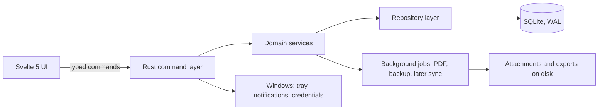

# Freelancer workspace app: plan

Date: 2026-11-17. A **plan, not an implementation**: nothing here is built, tested or reviewed. It follows the scenario and
recommendation in [CODE-COMPARISON.md](CODE-COMPARISON.md) ("Scenario: a Figma-designed all-in-one freelancer workspace") and the
tie-breakers in its section "Which stack for which app type". Claims about third-party libraries and legal rules are general
knowledge, not re-verified here, and are marked where they matter.

## 1. Product and scope

One Windows 11 desktop app for a freelancer that combines:

- **Issues and projects** (Linear style).
- **CRM and knowledge base** (Notion style): clients, contacts, pipeline, block-editor pages.
- **Invoicing and light ERP**: quotes, invoices, receipts, expenses, reports.

Hebrew and English are both first-class (RTL layout, mixed text, ILS). Data is **local-first**. Non-goals for v1: team
collaboration, a hosted backend, email sync (IMAP), mobile apps, a plugin marketplace.

## 2. Stack decision

| Layer | Choice | Why |
| --- | --- | --- |
| Shell | **Tauri v2** (Rust, WebView2) | The UI is made of web-shaped components (block editor, kanban, grids, command palette), the engine is Rust, calls are coarse. See CODE-COMPARISON.md. |
| Frontend | **Svelte 5** (runes), TypeScript, Vite (SvelteKit as an SPA) | Fits the existing skills. **React is the fallback** if the editor spike (section 8) fails. |
| UI primitives | Accessible headless components (bits-ui or shadcn-svelte style), Tailwind or CSS tokens from Figma variables | Accessibility without building primitives. |
| Editor | **TipTap / ProseMirror** | Framework-agnostic; BlockNote or Plate (React) are the alternatives. |
| Lists and tables | TanStack Table and Virtual, pragmatic-drag-and-drop | Virtualization and kanban without a framework lock-in. |
| Data | **SQLite** in Rust (`rusqlite`, bundled build with FTS5) | Section 4. |
| Types across the bridge | Generated TypeScript types from the Rust commands (for example `tauri-specta`) | One source of truth for the command surface. |
| PDF | Decided by spike S2: WebView2 print, or Typst/Rust | Hebrew bidi quality decides. |
| Secrets | Windows Credential Manager through a keyring crate | No tokens in the DB or the web layer. |

Not chosen: Qt, Avalonia and WinUI 3 (you would build the block editor and tracker pieces), Electron (kept as a reversible
alternative if built-in `printToPDF`, in-process Node modules or identical Chromium on macOS/Linux become necessary),
Flutter (the only credible native contender, but no web editor or grid ecosystem).

## 3. Architecture



- **Business rules live in Rust** (invoice numbering, state machines, validation, permissions). The frontend does UX
  validation, optimistic updates and presentation only.
- **The Rust side owns the database.** The frontend never gets a generic SQL channel.
- **Security posture:** minimal Tauri capabilities, local assets only, no remote content, file access only through native
  dialogs, a CSP reviewed per library (the benchmark's `style-src-attr 'none'` would reject many editor and grid libraries).
  Hardening follows the reference project's template in CODE-COMPARISON.md.

## 4. Data layer: why SQLite

The question was SQLite versus ESE (JET Blue) versus an in-memory store with an append-only log. From reading the sample
code (not running it):

| | ESE | In-memory + log (the C# demo) | SQLite |
| --- | --- | --- | --- |
| Platforms | Windows only | Any | Any (matches the macOS/web reach goal) |
| Queries | Hand-built indexes and joins | Same, in RAM | SQL: filters, reports, aging, VAT sums |
| Full-text, Hebrew | None | None | FTS5 (`unicode61`, no stemming) |
| Tooling | Almost none | None | DB browsers, `sqlite3`, migration libraries |
| Rust support | Raw Win32 bindings | N/A | `rusqlite`, mature |
| Sync later | Build it | Log is a natural op-log | Existing sync layers, or an op-log table |

Notes on the two samples, so the ideas are not lost:

- Both store money as `double`. Use integer minor units plus a currency code.
- The ESE sample has circular logging on (no log-based backup or point-in-time recovery) and no migration path.
- The log demo is **not crash-safe as written**: replay throws on a torn final record, so the database can fail to open after a
  power cut (it should truncate a bad tail and fail only on mid-file corruption). Its cascade delete is several separately
  flushed records without a commit marker, so it is not atomic. It has no snapshots, so startup grows with history; checks and
  ID allocation sit outside the lock; a record that fails to apply poisons every later startup; `DateTime.Now` is local time.
  Its speed claims were not measured.
- At freelancer scale (around 10^5 rows) all three should be far inside a 16 ms frame, so speed is not the deciding factor
  (not benchmarked here).
- The event idea belongs **on top of SQLite**: a `changes` op-log for sync and an append-only `invoice_events` table for audit.

### Schema rules

- STRICT tables, `foreign_keys=ON` on every connection, `journal_mode=WAL`, `synchronous=FULL`, a busy timeout, one writer
  connection plus a reader pool.
- IDs: UUIDv7 or ULID text. Money: integer minor units plus ISO currency code. Time: UTC. Soft-delete tombstones.
- Documents: ProseMirror JSON per page (Yjs updates later), with a derived plain-text column feeding FTS5. Attachments on disk,
  content-addressed, hash in the DB.
- Custom fields: a JSON column with generated, indexed columns for the fields that are filtered.
- Migrations by `PRAGMA user_version` with fixture-database tests. Scheduled backups with `VACUUM INTO`, and full export to
  JSON and CSV. Warn against storing the database in a cloud-synced folder. Optional SQLCipher later.
- Hebrew sorting: SQLite's default collation is binary; decide between a registered ICU-style collation and application-side
  sorting (spike S3).

## 5. Features and implementation direction

| Area | What | Direction |
| --- | --- | --- |
| Shell | Sidebar, tabs, Ctrl+K command palette, global search, tray quick-add | Keyboard-first; FTS5 search across issues, pages, clients, invoices; global shortcut and tray in Rust |
| Issues | List, board, saved views, labels, priorities, estimates | Saved views stored as validated query JSON compiled to parameterized SQL (never string-built); fractional-index ordering for drag-and-drop; virtualized lists; billable time can feed invoice lines |
| CRM | Clients, contacts, pipeline, activity timeline, custom fields, CSV import | Pipeline board shares the kanban component with issues; timeline from the `changes` log and notes |
| Pages / KB | Block editor: slash menu, headings, lists, toggles, tables, callouts, mentions, backlinks, templates | TipTap with `dir=auto` per block; links to issues and clients by ID; Markdown and PDF export |
| Invoicing | Products and services, quotes, invoices, receipts, payments, recurring invoices, multi-currency, expenses | Rust state machine draft, issued, paid or void; gap-free numbering per series inside one transaction; issued rows frozen by a trigger; audit in `invoice_events` |
| Reports | Revenue by client, receivables aging, VAT summary, accountant export | SQL views; CSV export |
| Tax and legal | Dated, configurable VAT setting; Israeli tax-authority allocation numbers and document-type rules | **Verify current rules with an accountant before building.** The integration is a later, isolated module behind an interface |
| Windows 11 | Mica on the sidebar, notifications, deep links, signed auto-update | Native caption kept for Snap; plugin behavior to be verified in spike S4 |
| Data safety | Backup, restore, export, language, theme, data location | Restore tested in CI with fixture databases |

## 6. UI direction

- **Look:** Linear's density with Notion's calm: neutral gray scale, one accent, hairline borders, 8 px radius, soft shadows;
  light and dark themes; motion of 120 to 200 ms that respects reduced-motion.
- **Fonts:** Inter and Noto Sans Hebrew (the repo's NeutronStar app already bundles both).
- **Tokens:** Figma variables map to CSS tokens; the Figma file plans RTL (mirrored layouts, logical properties,
  `dir=auto` for user content, `Intl` for ILS and dates; numbers and dates isolated LTR inside RTL text).
- **Layout:** left sidebar (collapsible), top breadcrumb and view switcher, main content, a resizable right detail drawer,
  centered command palette.

```
┌────────────┬──────────────────────────────────────┬──────────────┐
│ Workspace  │ Project ▸ Issues   [List|Board] ⌘K   │ Detail       │
│ Search     │ ─────────────────────────────────────│ drawer       │
│ Inbox      │ ○ ENG-12  Fix invoice PDF   ● High   │ (resizable)  │
│ Issues     │ ○ ENG-13  Client import     ○ Med    │              │
│ Clients    │ ...virtualized rows...               │ Title        │
│ Pages      │                                      │ Status, tags │
│ Invoices   │                                      │ Linked doc   │
└────────────┴──────────────────────────────────────┴──────────────┘
```

## 7. Phases

| Phase | Work | Exit evidence |
| --- | --- | --- |
| P0 spikes (1 to 2 weeks) | S1 to S5 below | Written pass/fail per spike with versions |
| P1 spine | Tauri shell, SQLite and migrations, typed commands, issues, command palette, global search | Migration and crash-recovery tests; keyboard walk-through |
| P2 CRM and pages | Clients, pipeline, block editor, backlinks | Hebrew/English editing checks; export round trips |
| P3 money | Invoicing, numbering, PDF, reports | Accountant review of numbering and VAT model; PDF visual checks |
| P4 later | Sync (op-log plus Yjs for documents), macOS, optional encryption | Separate plan |

## 8. Spikes before committing

- **S1 editor:** slash menu, drag handle, table block and mixed Hebrew/English typing in TipTap on Svelte, versus BlockNote on
  React. Decide Svelte or React by the result, not by ecosystem size.
- **S2 PDF:** a Hebrew invoice with ILS, mixed text and numbers through WebView2 print versus Typst.
- **S3 SQLite:** FTS5 search on Hebrew (with and without niqqud), collation choice, migration and backup procedure, a kill-during-
  write test.
- **S4 Windows polish:** Mica, tray, notifications, deep links, global shortcut and updater behavior under Tauri.
- **S5 lists:** a 10,000-row virtualized issue list and drag-and-drop on a mid-range machine.

## 9. Testing

Rust unit tests for domain rules; migration tests on fixture databases; kill-during-write and restore tests; Hebrew/RTL visual
checks; keyboard and screen-reader walk-throughs; end-to-end tests through the WebView2 driver.

## 10. Risks and open questions

- The block editor is the hardest single component; the spike may flip the frontend to React.
- PDF generation with correct Hebrew bidi is not built into Tauri and is untested here.
- Legal invoicing rules (numbering, allocation numbers, document types) must come from an accountant, not from this plan.
- WebView2 availability and servicing; WebKit differences if macOS is added later.
- A CSP compatible with every chosen editor and grid library must be written and reviewed.
- Scope is large for a solo build; P1 to P3 is the minimum useful product, and each phase should ship usable value.
