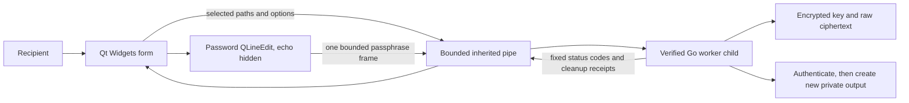

# Zodiac Modern desktop GUI: Qt Widgets over the Go worker (plan)

Date: 2026-11-17. Backlog items: **FUT-09** (optional Windows 11 GUI around the Go receiver) and, for the encrypt operation, **FUT-11** (optional offline Go encryption, deferred).

**This is a plan, not an implementation.** No Qt GUI, Go worker, protocol, spike or measurement described here exists yet.
Nothing below has been built, tested, reviewed or approved, and nothing here is a security claim. It follows
[AGENTS.md](AGENTS.md) and the receiver policy in [plan.md](plan.md). Earlier research is in
[desktop/desktop-gui.md](desktop/desktop-gui.md) (which ranked Avalonia first and Qt fourth, before the licensing and
language decisions below) and [desktop/CODE-COMPARISON.md](desktop/CODE-COMPARISON.md) (security-sensitive apps).

## 1. Decisions and scope

| Decision | Choice | Source |
| --- | --- | --- |
| GUI toolkit | **Qt Widgets** (C++), Qt 6.12 shared libraries. Not Qt Quick or QML (QML belongs to Qt Quick; Widgets is plain C++ `QWidget` classes, and the two can be embedded in each other, which this app does not need). | User, 2026-11-17 |
| Operations | **Decrypt and encrypt** in the GUI. **Key generation later**, as a reviewed script opened in its own console window, not an in-process feature (section 3A). | User, 2026-11-17 |
| Docking | **No KDDockWidgets in v1.** The receiver is one form; docking adds a dependency (its licence differs from Qt's LGPL) for no use. Revisit only if a multi-pane view is added. | User, 2026-11-17 |
| Licence | LGPL with **dynamically linked, relinkable** Qt DLLs. No static link. | User, 2026-11-17 |
| Passphrase entry (primary) | **Qt password box**, sent once to the Go worker over a **dedicated inherited channel**. | User, 2026-11-17 |
| Go-owned Win32 password dialog | **Not the default and never in the CLI default.** Possible only as an opt-in worker mode, decided by the research gate in section 7. | User, 2026-11-17 |
| Who owns crypto | **Go owns** key parsing, PBES2 policy, RSA/OAEP/GCM, canonical decoding, bounds, output and cleanup. The GUI collects input and shows status. | [AGENTS.md](AGENTS.md) |

Non-goals: crypto in C++/Qt (all of it stays in Go), hosted private-key form, listener or local web service, generic file or shell bridge, updater, tray, history,
saved passphrase, plaintext preview, clipboard or editor launch, Qt Quick/QML, browser engine. Receiver and CLI behavior
stay as in plan.md; the standalone CLI keeps its terminal-only passphrase prompt. Encrypt is not available until FUT-11 (a Go encryption command) is selected and built; the GUI does not implement it separately.

## 2. Why Qt Widgets here (reasons, checked)

Corrections to the reasoning that led to this choice, so the document does not repeat them as facts:

- **It is still two languages and two processes.** The GUI is C++ and the receiver is a Go child. "No P/Invoke" is true; "one
  runtime" is not. Loading Go in-process as a c-shared DLL is the other route, with FFI, runtime lifetime and in-process
  secrets (see desktop-gui.md section 8). It stays deferred.
- **The benchmark does not support "faster".** The benchmark measured Qt **Quick**, not Widgets, on a synthetic list
  workbench. This receiver is a four-field form whose cost is PBKDF2 inside Go, so toolkit speed is not a deciding factor.
- **Real reasons for Qt Widgets:**
  1. No browser or web layer anywhere in the trust path; the passphrase never exists in a browser process.
  2. Direct Win32 handle plumbing (`CreateProcessW` with an explicit handle list) from C++, with no marshalling layer.
  3. C++ owns the buffers the app creates, so they can be zeroed.
  4. LGPL with relinkable DLLs is acceptable to the project.
  5. Native look and behavior of standard Widgets controls, native file dialogs, and Qt's UI Automation bridge (to be verified).

| Aspect | Qt Widgets (this plan) | Avalonia (desktop-gui.md leader) | Tauri v2 + Svelte + Rust-owned secret |
| --- | --- | --- | --- |
| Browser in the trust path | None | None | WebView2 runtime, JS bridge and web UI present (secret kept out of JS) |
| Host language safety | C++ (memory-unsafe) | C# (memory-safe), native Skia/HarfBuzz underneath | Rust (memory-safe), plus the WebView2 runtime |
| Secret wiping | Owned buffers can be zeroed; `QString` and control copies cannot | .NET string copies cannot; pinned buffers can | Rust `zeroize` on owned buffers; JS never holds the secret |
| Handle plumbing to Go | Direct Win32 from C++ | P/Invoke for handle inheritance, or named pipes | Rust `windows` crate |
| Trusted base to review | Qt (Core, Gui, Widgets, one platform plugin) + Go | .NET runtime + Avalonia + Skia + Go | WebView2 + Tauri/Wry + Rust host + command bridge + Go |
| Licence | LGPL, relinkable DLLs | MIT | MIT/Apache-2.0 |
| IME and AT on the password field | To verify (section 6) | To verify | To verify (native prompt in Rust) |

So Qt Widgets has a **smaller trusted base and no web attack surface** than Tauri. It does **not** have a memory-safe host
and does not remove the need for the review work in section 10. That trade-off is the reason, not benchmark speed.

## 2A. Decision record: a separate Go process, not an in-process Go DLL

The GUI could reach the Go receiver in three ways. This is the reasoning behind the choice (see also section 5).

| Option | One language? | Verdict |
| --- | --- | --- |
| **Go child process over an inherited pipe** (this plan) | No (C++ and Go) | **Chosen** |
| Go as a c-shared DLL loaded into the Qt process | No: still a C++ runtime and a Go runtime, only inside one process | Deferred |
| Reimplement the receiver in C++ (CNG or OpenSSL) | Yes | Rejected |
| A Go GUI (Wails, Fyne and similar) | Yes | Not Qt; outside this choice |

Why the child process:

- **The DLL does not reach "one runtime".** It would add a cgo build (on Windows normally a MinGW-style C toolchain beside
  clang-cl/MSVC), start a Go runtime with its own threads and GC inside Qt's process, and cannot be unloaded safely. The
  two-language cost stays; it just moves in-process.
- **Fresh process per message.** plan.md requires no resident cache or history. A worker that exits after one operation gives
  that for free; a resident DLL does not.
- **One audited code path.** The GUI and CLI run the same Go code, so there is one decrypt implementation to review. A C++
  reimplementation would repeat the mandatory PBES2 loader, OpenSSL fixture, fuzz and independent-review gates and leave two
  implementations to keep consistent (the Go CLI stays regardless).
- **Isolation and a small interface.** A worker crash or hang does not take down the form. The boundary is one anonymous pipe, a
  bounded frame grammar and fixed status codes. Process start cost is negligible next to PBKDF2 at 600,000 iterations.
- **Not a differentiator:** Go may copy secrets when it grows stacks, in either arrangement.

Revisit only if spike S2 shows the pipe protocol to be a real source of bugs, which is not expected. This does not make the
design a sandbox: both processes run as the same user (section 5).

Other findings recorded here so they are not lost:

- **QML belongs to Qt Quick.** Qt Widgets is C++ `QWidget` classes. The two can be embedded in each other (`QQuickWidget`), but
  this app does not need QML.
- **Qt in pro apps is mixed.** Qt Widgets and docking libraries are common for dock-heavy creative tools, and Qt Quick for
  newer UI. The installed-app survey only shows `QApplication` linked in Photoshop, which is not proof of its UI stack.
- **Qt Widgets is the lower-risk Qt flavor for a security form:** no QML engine and no JavaScript evaluation inside the GUI
  process (compare the QML note in desktop-gui.md section 5.15).

## 3. Architecture

The diagram shows access, not permission to send file contents back. Plaintext, private-key bytes and AES material stay in
Go. One short-lived worker process handles one operation; no resident cache or history.

Window (one `QMainWindow`, no docking), per desktop-gui.md section 10:

| Area | Behavior |
| --- | --- |
| Message | Choose one raw ciphertext `.txt` (native `QFileDialog`); artwork inputs are rejected with raw-file guidance |
| Private key | Choose one encrypted PKCS#8 PEM; contents never shown or cached |
| Output | Choose a **new** plaintext path; the picker does not create or overwrite it; Go re-checks the local fixed-disk rules |
| Cleanup options | Separate unchecked `--cleanup-output` and `--single-use-key` choices with their irreversible, best-effort wording |
| Passphrase | Masked field, explicit Cancel, no save option |
| Action | One "Decrypt to file" button, enabled only for a coherent form |
| Status | Real stages only (validating, unlocking, authenticating, writing, waiting for finish, cleanup result); no invented percentage |
| Completion | "File written" is shown separately from "cleanup done"; plaintext is never displayed |

Close, Cancel and "Finish reading" have different meanings and must be defined against the worker's state before any code.
Closing the window never deletes a key before authenticated output succeeded.

## 3A. Operations: decrypt, encrypt and key setup

| Operation | Needs | Who does the crypto | Passphrase |
| --- | --- | --- | --- |
| **Decrypt** | Existing receiver (`decrypt`, `verify-key`) | Go | Yes (sections 5-7) |
| **Encrypt** | **FUT-11**: a Go encryption command using the unchanged v1 envelope; not yet selected or built | Go (standard library), never Qt | None (public key only) |
| **Key setup** | A reviewed script and a pinned OpenSSL; later, optional | OpenSSL in its own console | Typed in OpenSSL's own prompt |

**Encrypt (depends on FUT-11, which is deferred).** The website encrypts with WebCrypto. A GUI encrypt would call a Go worker
that implements the same profile: one strict RSA-3072/4096, e=65537 SPKI public PEM, fresh 32-byte AES key and 12-byte nonce,
OAEP SHA-256/MGF1-SHA-256 with an empty label, AES-256-GCM, AAD `wrappedKey || nonce`, envelope `wrappedKey || nonce || tag ||
ciphertext`, canonical unpadded Base64URL. FUT-11's acceptance criteria apply unchanged, including interoperability checks
against the website sender and the Go receiver. Qt adds no cryptographic code.

- **Public key:** the user picks a PEM file. Show the full fingerprint and the words "configured/parsed", not "verified", unless
  an independent comparison happened (SEC-05 rule). Keep independent-comparison guidance visible.
- **Message input:** either typed text or a chosen file. Typed text lives in the Qt editor (undo buffers, accessibility and
  `QString` copies that cannot be wiped) and crosses the pipe once as a bounded UTF-8 frame. This is a real difference from
  decrypt, where plaintext never reaches the shell. A chosen file keeps the text out of Qt but leaves a plaintext file on disk,
  which the UI must disclose. Never send plaintext in argv or the environment.
- **UTF-8 rule:** `QString::toUtf8` silently replaces lone surrogates with U+FFFD. The shell must reject lone UTF-16
  surrogates before conversion (the same rule the website applies to JS strings), preserve valid text exactly, and enforce the
  message bound before sending.
- **Output:** raw ciphertext is not secret and may be returned to the UI (at most 88,102 characters), shown, copied by an
  explicit Copy button or saved as a `.txt`. Raw ciphertext stays primary. PNG or SVG artwork stays a website feature; the
  receiver consumes raw text only, and no art-only sharing may imply the recipient can decrypt from art.
- **Plaintext is never copied to the clipboard** and the form clears the editor after a successful or cancelled operation.

**Key setup (later, as a script in a new window).** Running OpenSSL from the GUI with passphrase fields would put
passphrases in a second place, so the plan keeps passphrases out of Qt and Go for generation:

- A button starts a **reviewed, signed script** shipped in the release folder, in a new console window
  (`CREATE_NEW_CONSOLE`), launched by pinned full paths with no shell string built from user input. It runs the commands in
  plan.md (`openssl genpkey` with an encrypted intermediate, `openssl pkcs8 -topk8 -v2 aes-256-cbc -v2prf hmacWithSHA256 -iter
  600000 -saltlen 16`, `openssl pkey -pubout`, `openssl pkey -check`). OpenSSL prompts for passphrases in that console; Qt and Go
  never see them.
- Preconditions the script must check before the first command: pinned OpenSSL 3.5 LTS path and `openssl version`, a private
  nonsynced folder outside the repository with a restrictive Windows ACL applied first, and a no-overwrite check. It prints the
  public-key fingerprint, and never claims secure erasure of the intermediate.
- After the script, the GUI may run `verify-key` through the normal worker passphrase flow to confirm that the private and
  public halves match. Browser or in-app private-key generation remains outside v1 (AGENTS.md).
- Open questions for later: where the verified OpenSSL lives, and how a signed script is hash-checked before it starts.

## 4. Go side changes (`receiver/`)

Existing seams, verified in `receiver/cmd/zodiac-decrypt/main.go`: `runWithPromptAndFinish(args, prompt, finish)` with
`prompt func(context.Context) ([]byte, error)` and `finish func(context.Context) error`; the CLI wires `cli.Prompt` and
`cli.WaitForFinish` from `receiver/internal/cli/password.go` (hidden controlling terminal, 1,024-byte bound, rejects
redirected input). Flags today: `decrypt --key --in --out [--cleanup-output] [--single-use-key]`. Exit codes: 0 success, 2
usage/input, 3 key unlock, 4 message failure, 5 local I/O or cleanup, 130 cancel.

Plan:

1. **Extract** the decrypt orchestration from `package main` into a small internal service shared by the CLI and the worker,
   reusing `internal/keyfile`, `internal/envelope` and `internal/localfile`. No policy is duplicated in C++. This refactor
   and its regression evidence are new work.
2. **Add a worker entry point** (for example `cmd/zodiac-decrypt-worker`) in the same Go module, so internal packages stay
   reusable. Whether it is a subcommand or a separately named, separately signed binary is decided in M1 (section 10).
3. **Pluggable passphrase provider**, selected by the launcher, never inferred:
   - `terminal`: today's behavior; **the only CLI default, unchanged**.
   - `channel`: reads one passphrase frame from the inherited pipe; the GUI default.
   - `win32-dialog`: opt-in only, research (section 7). Never started unless the GUI passes it explicitly.
4. **Keep the error taxonomy**: all unlock, profile, password, padding and private-key failures remain one category
   (exit/status 3). The protocol must not introduce distinctions the CLI deliberately hides.
5. **Report success and cleanup separately.** A worker crash is never reported as "cleaned".

## 5. Inherited-channel protocol (to specify before coding)

Based on desktop-gui.md section 9, not yet reviewed:

- Dedicated **anonymous inherited pipe handles**, separate from stdin, with an explicit handle allowlist
  (`PROC_THREAD_ATTRIBUTE_HANDLE_LIST`). No named pipe, socket, HTTP or any addressable listener.
- Launch with C++ `CreateProcessW` and `STARTUPINFOEX`. Do not assume `QProcess` can do this; a spike (S2) checks whether
  `QProcess::setCreateProcessArgumentsModifier` is sufficient. Go's `exec.Cmd.ExtraFiles` is not supported on Windows, but the
  worker is started from C++, so the Go side only needs to open the inherited handle values it is told about
  (`os.NewFile` or `golang.org/x/sys/windows`).
- Handle numbers are passed as ordinary arguments. They are not secrets but must be validated. Close unused ends promptly in
  both processes.
- A **versioned, length-bounded frame grammar** with caps on path fields, request size, passphrase bytes (at most 1,024, as in
  `password.go`) and status frames, all checked before allocation. One operation identifier per child; reject duplicates,
  replays, out-of-order frames, version mismatch, oversize frames and unexpected EOF. No generic object invocation.
- Allowed requests: select an operation (`decrypt`, `verify-key`, later `encrypt`), set paths and options, start, submit the passphrase once (decrypt and verify only), submit the bounded message frame (encrypt only), cancel, acknowledge finish. Allowed replies: fixed
  stage codes, the exit-category code, and cleanup receipts. **No decrypted plaintext, key bytes, free-form debug text or secret in any
  reply, log or exception string.** Encrypt replies may carry the (non-secret) raw ciphertext.
- Launch only a **pinned full path** to the worker, no PATH search and no shell; verify its hash/publisher against the release
  manifest first; constrain the working directory and DLL search. A hash check does not defeat a compromised local account.
- Cancellation and completion are acknowledged with bounded waits. Never kill the worker mid-write and infer a result.
- A successful launch is **not a sandbox**. Both processes run as the same user; same-user malware with debug or injection
  rights is outside what this separation protects.

## 6. Passphrase handling in Qt

- Use the stock `QLineEdit` in password echo mode, with input hints for hidden text, no predictive text and sensitive data
  (`Qt::ImhHiddenText | ImhNoPredictiveText | ImhSensitiveData`), clipboard copy/cut, context menu and drag disabled, and a
  validator limiting the UTF-8 length to the receiver's 1,024-byte bound. Preserve valid Unicode exactly; reject malformed
  UTF-16 rather than substituting U+FFFD (AGENTS.md).
- Convert to a UTF-8 buffer the app owns, send one frame, then `SecureZeroMemory` the buffer and clear the control on every
  path (success, failure, cancel, close).
- **Limits to state in the product docs:** `QString` is implicitly shared and the control keeps its own copies (including any
  undo or accessibility state), so wiping is not guaranteed. This plan does not claim erasure.
- A custom secret-entry widget is rejected unless spike S1 shows the stock control fails, because it would have to
  re-implement UI Automation and IME handling itself.
- Programmatic probe (section 7): in Qt 6.12.0 password mode disables the IME context, UI Automation reports `IsPassword = True`
  with bullet characters only, and Ctrl+C/Ctrl+X do not copy the text. How Narrator/NVDA announce it, and real IME behavior,
  must still be checked with **physical** assistive technology, not only a UIA tree report (see the repo's own rule in
  CODE-COMPARISON.md).

## 7. Research gate: Qt password box or Go-owned dialog

Decision question: should the passphrase be typed in the Qt form and sent to the Go worker (A), or typed in a native Win32
dialog that the Go worker shows itself (B)? The constraints: the CLI never pops dialogs by default, Qt owns the UI design, and
the app should not grow a second UI layer.

### What was checked (2026-11-17; sources and scripts in [docs/spikes/gui](docs/spikes/gui/README.md))

These are throwaway probes with synthetic strings on one machine (Windows 11 10.0.26200, Qt 6.12.0, Go 1.25.5). **No physical
screen reader or IME was used. This is not a security test or review.**

| Check | A. Qt `QLineEdit` password mode | B. Native `EDIT` with `ES_PASSWORD` (raw Win32 window from Go) |
| --- | --- | --- |
| UI Automation `IsPassword` | **True** (also with the extra input hints) | **Not established**: the raw control surfaced as a generic Pane without patterns, which looks like a limit of the probe, not a verdict on Windows dialogs |
| Value/Text exposed to UIA clients | Bullet characters only; a normal field exposes its text | Not established |
| IME context while focused | **Disabled** (`ImmGetContext` NULL); same with echo mode alone | **Disabled** (`ImmGetContext` NULL); plain edit non-NULL |
| Clipboard copy/cut of the secret | Ctrl+C and Ctrl+X do not place it on the clipboard; Ctrl+X still deletes the text | Not tested |
| Windows 11 style available | Yes: `qmodernwindowsstyle` plugin ships in the Qt 6.12 kit (appearance not yet judged) | Win32 common-controls look; needs manifest and dark-mode handling |
| Pipe from C++ to a Go child | **Works**: `CreateProcessW` + handle list, Go `os.NewFile`, bounded frame, oversize frame rejected, unlisted inherited handle did not leak | Not needed (Go owns the dialog) |

### Reading

| Criterion | A. Qt box + channel (default) | B. Go `win32-dialog` (opt-in) |
| --- | --- | --- |
| Processes that see the passphrase | Qt GUI and Go worker | Go worker only |
| UI design control | Qt, consistent with the form | A Win32 dialog styled separately; owner window and modality managed by hand |
| Accessibility, IME | Measured above: IME off, `IsPassword` true; physical AT still to test | IME off; UIA unknown; physical AT still to test |
| DPI, dark mode, high contrast | Handled by Qt (still to verify in S4) | Dialog must be made DPI-aware, themed and manifested by hand |
| Code to write and review | A password line plus one frame | Win32 dialog code in Go (templates, message loop, focus, owner), all new native code |
| Failure modes | Pipe protocol bugs (bounded by the grammar) | Focus, Z-order, owner-window and cancel-while-open bugs |
| CLI impact | None | Extra Windows-only path that must stay off by default |

### Decision (provisional, until S1 and S5 pass physically)

**Keep A as the default and the only supported path in v1.** The measured behavior of the stock Qt control is at least as good
as the native edit on the points that could be checked (IME off, UIA password flag, bullets only, clipboard blocked), and B adds
a second UI layer, which the user ruled out as a default. B stays a **documented, opt-in worker mode, not built** unless physical
testing shows a decisive win for it, in this order of evidence:

1. S1 (physical Narrator/NVDA and IME) shows the Qt field misbehaves in a way a native dialog does not.
2. A properly built Go dialog (template, manifest, owner window) is shown to expose the correct UI Automation role and password
   flag, which the raw probe could not.
3. The reviewers judge fewer processes seeing the passphrase to outweigh the added native code.

If B is ever built, the Qt UI and the frame protocol stay the same; Qt shows a "waiting for passphrase" state, and the dialog is
started only when the GUI passes the option explicitly. The standalone CLI keeps its terminal prompt.

### Still open

- Physical Narrator/NVDA announcement of the Qt password field, and typing with an IME-using language (a disabled IME also means
  such users cannot compose a passphrase through an IME; passphrase guidance already prefers ASCII).
- Behavior with password-manager and autofill paths that act through UI Automation.
- B: a real dialog's UIA exposure and DPI/dark behavior (only if B is pursued).
- Handle-inheritance races, cancellation and the full frame grammar (S2 proper); the probe covered only the basic mechanism.

## 8. Qt build, packaging and licence

- Reuse the working Qt scaffolding in `desktop/Qt/`: `Build.ps1`, `CMakeLists.txt`, `CMakePresets.json`,
  `scripts/Acquire-Qt.py`, `Toolchain.ps1`, `Write-Notices.py`, the clang-cl + MSVC `link.exe` notes and relocatable
  `qt.conf`, plus the VC++ redistributable copy. That project is Qt **Quick**; re-check every assumption for Widgets.
- Modules: Core, Gui and Widgets only. Ship the `qwindows` platform plugin and the Windows 11 Widgets style (verify it exists
  and looks right in the 6.12 kit; S4). **Ship no other plugins**, in particular no image-format plugins, to keep the
  loaded-code surface small.
- Pin library and plugin paths through `qt.conf` and explicit library paths, and restrict the DLL search order. Document that
  Qt-related environment variables can redirect plugin loading, and that an attacker who controls the user's environment can
  already run code as that user.
- LGPL obligations: dynamic linking only, relinking information, licence notices, an audit of each shipped module and plugin
  before release. This is a release gate, not a formality.
- Delivery stays as plan.md requires: portable folder, no installer, administrator access, runtime download or updater;
  Authenticode-signed executables, per-file and final hashes through a trusted channel, reviewed manual releases.

## 9. Accessibility, international text, DPI

- UI Automation through Qt's accessibility; Narrator and NVDA, keyboard-only use, high contrast, text scaling, visible focus
  and no information carried by color alone.
- 100/150/200% DPI and multiple monitors; software rendering and Remote Desktop.
- Hebrew and bidirectional file names: show untrusted names as text with bidi isolation, never as markup or a command; long
  paths; non-ASCII names. The native picker may show network locations, and Go's local-disk/reparse/ACL checks must still
  reject them at the operation boundary.
- Responsive UI during PBKDF2; do not imply Cancel interrupts a running KDF immediately.

## 10. Milestones and gates

Nothing is marked done without its evidence. Independent review is separate from implementation.

| Milestone | Work | Evidence required |
| --- | --- | --- |
| M0 spikes | **S1** stock password control: IME, UIA `IsPassword`, clipboard/drag disabled. **S2** inherited handle start of a Go child and one passphrase frame. **S3** optional Go dialog. **S4** Widgets Windows 11 style, dark mode and high contrast in Qt 6.12. **S5** UIA tree check using `desktop/host-test-support/candidate-checks`. | Recorded versions, observed behavior, written pass/fail, no secrets. **Status 2026-11-17:** partial programmatic probes for S1, S2, S3 and S4 are in [docs/spikes/gui](docs/spikes/gui/README.md); physical AT/IME, the full protocol, a real Go dialog and the Widgets look are still open. |
| M1 Go | Operation service extraction, worker entry point, provider interface, protocol grammar, tests and fuzzing of frames (oversize, replay, EOF, order) | Existing CLI tests still pass; new tests; unchanged CLI behavior and exit codes |
| M1b encrypt | Gated on FUT-11 selection: Go encrypt command, interoperability with the website sender and Go receiver, frame for the message and ciphertext | FUT-11 acceptance criteria met first; independent review of the new Go code |
| M2 Qt form | Widgets form, launcher (`CreateProcessW`), state machine for stages/cancel/finish | Qt tests; keyboard walk-through; no secret in logs or UI state |
| M3 end to end | Real runs with `receiver/tests/fixtures/keys` (RSA-3072/4096; OpenSSL 3.0, 3.5 and rewrapped keys): success, wrong passphrase, tampered input, existing output, spaces and Hebrew paths, cancel | Output compared with the independent oracle; failure categories match the CLI |
| M4 trials | Physical Narrator/NVDA and IME checks, DPI/monitor changes, novice trials | Recorded findings and fixes |
| M5 release | Signing, per-file hashes, notices, LGPL relink package, clean-machine check, independent boundary review | No unresolved critical/high findings |

## 11. Risks and open questions

- **Scope growth:** encrypt depends on FUT-11, a separate deferred decision. Decrypt can ship first.
- **Plaintext in the shell for encrypt** (editor undo and copies, section 3A), unlike decrypt.
- **Key-setup script launch** must not build a command from user input, and needs a verified OpenSSL.
- **C++ memory safety** of the shell. Mitigate with narrow code, bounded parsing only on the Go side, and review; not removed.
- **Qt plugin and DLL loading surface** and environment-driven redirection (section 8).
- **Secret copies**: `QString`, control and accessibility copies cannot be wiped (section 6).
- **Handle-inheritance races** and cleanup of unused pipe ends; whether `QProcess` can be used at all (S2).
- **Windows 11 look and dark/high-contrast fidelity** of Widgets in 6.12 (S4); Widgets is classic-controls based, so
  design polish may need custom painting, which costs accessibility if overdone.
- **Hidden-text IME and UIA behavior:** the programmatic probe passed (section 7); physical assistive-technology and IME checks remain open (S1).
- Not covered: macOS/Linux, ARM64, non-ASCII OpenSSL prompt compatibility (plan.md notes it as unproven).

## 12. Follow-ups when implementation starts (not now)

- Record the Qt Widgets selection in FUT-09 and add a pointer from `desktop/desktop-gui.md`; no `backlog.md` status change is
  made by this document.
- Add the new worker, protocol and tests to the receiver's validation and release gates.
- Do not describe the GUI as implemented, secure or reviewed until the evidence in section 10 exists.
